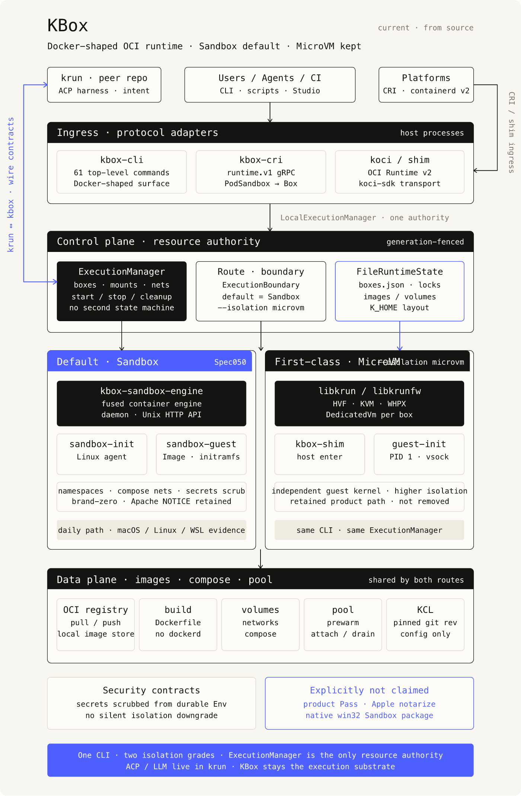

# KBox

A **Docker-shaped OCI runtime** for local agents and workloads. Same CLI shape as Docker (`run` / `exec` / `compose` / …); isolation is graded:

- **Default — Sandbox** — fused in-tree container engine (Apache-2.0 provenance, brand-clean)
- **First-class — MicroVM** — still supported; `kbox run --isolation microvm` via libkrun / libkrunfw (higher isolation, not removed)

English | [简体中文](README.zh-CN.md)

## Architecture

Current control plane and dual isolation backends (from source, Spec050 / v3.4.5 era):



[Editable SVG](docs/architecture/kbox-architecture.svg) · Kense OS blueprint style

```text
Users / CLI / CRI / shim
        │
        ▼
ExecutionManager  (sole resource authority)
        │
        ├─ default ► Sandbox engine daemon + guest
        └─ kept   ► libkrun MicroVM (DedicatedVm, --isolation microvm)
```

- **One CLI, two isolation grades** — Sandbox is default; MicroVM stays a supported upgrade path.
- **ExecutionManager owns** boxes, mounts, networks, generations; no silent isolation downgrade.
- **ACP / LLM** live in peer repo `krun`; KBox is the execution substrate.

## Install

macOS arm64 (Apple Silicon), GitHub Release `v3.4.5`:

```sh
# from the release assets on https://github.com/kense-labs/kbox/releases/tag/v3.4.5
tar -xzf kbox-3.4.5-macos-arm64.tar.gz
KBOX_PREFIX="$HOME/.kbox" sh kbox-3.4.5-macos-arm64/install.sh
xattr -dr com.apple.quarantine "$HOME/.kbox" || true   # until notarize lands
export PATH="$HOME/.kbox/bin:$PATH"
kbox version
```

```sh
kbox update --check
kbox update
```

Package ships `kbox`, `kbox-sandbox-engine`, sandbox guest, plus MicroVM companions (`kbox-shim`, libkrun, …). ≠Pass / ≠notarize — Gatekeeper may still need the quarantine clear above.

## Quick start

Default Sandbox path:

```sh
kbox run --rm alpine:3.20 -- echo hello-kbox
```

Detached service with publish:

```sh
kbox run -d --name web -p 8080:80 nginx:alpine
curl -fsS http://127.0.0.1:8080/ | head
kbox rm -f web
```

Higher isolation (same CLI):

```sh
kbox run --rm --isolation microvm alpine:3.20 -- echo hello-microvm
```

Full top-level command matrix (61): `bash scripts/e2e-sandbox-full.sh`  
Perf vs OrbStack evidence: [`docs/evidence/runtime/20261118-sandbox-perf-orbstack/`](docs/evidence/runtime/20261118-sandbox-perf-orbstack/)

## What you get

| Area | Support |
| --- | --- |
| Images | `pull` / `build` / `commit` / `export` / `import` / login |
| Run | `-d`, `-i`, `-v`, `-e`, `-p`, `-u`, `--rm`, limits, `--isolation` |
| Compose / pool | Multi-service; Sandbox networks; `pool start --prewarm` |
| Snapshot / volume / network | First-class CLI groups |
| Isolation | **Sandbox default** · **MicroVM supported** (`--isolation microvm`) |

Command details: `kbox --help` (source of truth).

## Platforms

| Host | Default Sandbox | MicroVM | Prebuilt package |
| --- | --- | --- | --- |
| macOS arm64 | Yes (fused engine) | HVF + libkrun | Yes (`v3.4.5`) |
| Linux | Yes (namespaces; root for full path) | KVM | Build / qualify |
| Windows | Via WSL2 Linux path | WHPX in-tree | Build / qualify |

Native win32 Sandbox package is not claimed. Evidence: darwin packaged + Windows WSL 61/61 coverage.

## Development

```sh
git clone --recursive https://github.com/kense-labs/kbox
cd kbox
cargo build --locked -p kbox-cli -p kbox-sandbox-engine
cargo fmt --all -- --check
cargo check --workspace --all-targets --locked
```

Always set a task-owned `K_HOME` before local tests.

Layout:

```text
crates/box/           CLI · runtime · sandbox engine
crates/oci-runtime/   OCI / DedicatedVm stack
crates/runtime/       Task / Service contracts
libkrun/ libkrunfw/   virtualization submodules
docs/architecture/    Kense OS–style diagrams
```

## License

MIT. See [LICENSE](LICENSE). Submodules and fused sandbox engine retain their upstream licenses / NOTICE.
