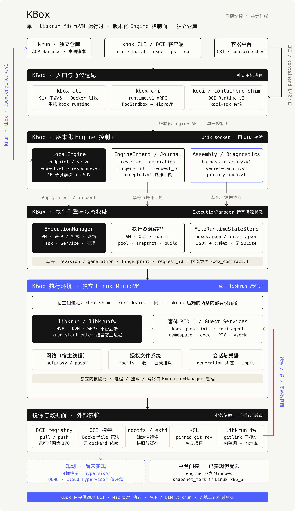

# KBox

面向本地 Agent 与 OCI 工作负载的 **Docker 风格运行时**。CLI 形态与 Docker 同形（`run` / `exec` / `compose` / …）；隔离分级：

- **默认 — Sandbox**：仓内融合的容器引擎（Apache-2.0 溯源、零上游产品品牌）
- **正式保留 — MicroVM**：继续支持；`kbox run --isolation microvm`，经 libkrun / libkrunfw（更高隔离，不是砍掉）

[English](README.md) | 简体中文

## 架构

当前控制面与双隔离后端（源码实态，Spec050 / v3.4.5）：



[可编辑 SVG](docs/architecture/kbox-architecture.svg) · Kense OS 蓝图样式

```text
用户 / CLI / CRI / shim
        │
        ▼
ExecutionManager  （唯一资源权威）
        │
        ├─ 默认 ► Sandbox 引擎守护进程 + guest
        └─ 保留 ► libkrun MicroVM（DedicatedVm，`--isolation microvm`）
```

- **同一 CLI、两级隔离** — Sandbox 为默认；MicroVM 仍是受支持的升级路径。
- **ExecutionManager** 持有 box / 挂载 / 网络 / 代次；禁止静默降级隔离。
- **ACP / LLM** 在对等仓库 `krun`；KBox 是执行基底。

## 安装

macOS arm64，GitHub Release `v3.4.5`：

```sh
# 资产见 https://github.com/kense-labs/kbox/releases/tag/v3.4.5
tar -xzf kbox-3.4.5-macos-arm64.tar.gz
KBOX_PREFIX="$HOME/.kbox" sh kbox-3.4.5-macos-arm64/install.sh
xattr -dr com.apple.quarantine "$HOME/.kbox" || true   # 公证落地前
export PATH="$HOME/.kbox/bin:$PATH"
kbox version
```

包内含 `kbox`、`kbox-sandbox-engine`、sandbox guest，以及 MicroVM 配套。≠Pass / ≠公证。

## 快速开始

默认 Sandbox：

```sh
kbox run --rm alpine:3.20 -- echo hello-kbox
```

更高隔离（同一 CLI）：

```sh
kbox run --rm --isolation microvm alpine:3.20 -- echo hello-microvm
```

61 命令全覆盖：`bash scripts/e2e-sandbox-full.sh`

## 性能（对标 OrbStack）

主比 **生命周期**（create / start / run / exec / stop / …），不以 registry
`pull` 论胜负。darwin arm64：kbox Sandbox（`release-dist`）vs 本机
**OrbStack Docker 29.8.2**；暖机 + 镜像已缓存；公平对要求两侧 `rc=0`。

| 生命周期（暖机） | kbox | OrbStack | 比值 |
| --- | ---: | ---: | ---: |
| `run --rm` | 194 ms | 274 ms | 0.71 |
| `create` | 54 ms | 87 ms | 0.61 |
| `start` | 28 ms | 82 ms | 0.34 |
| `exec` | 6 ms | 26 ms | 0.24 |
| `stop` | 25 ms | ~10.1 s | ≪1 |
| `restart` | 36 ms | ~10.2 s | ≪1 |
| `compose up -d` | 135 ms | 289 ms | 0.47 |
| `cp` | 9 ms | 18 ms | 0.51 |
| `commit` | 240 ms | 194 ms | 1.24 |

41 个暖机公平对：kbox 更快 **39**，更慢 **1**（`commit`）；比值中位 **0.34**。
新鲜 daemon 后的首次 `run` 仍约 3.5–4 s（一次性拉起）；稳态生命周期保持亚秒。

冷 `pull` 受 Hub 鉴权/网络主导，**不纳入本结论**。61 命令全表与 Windows WSL
对照见证据目录。≠Pass。

## 平台

| 宿主 | 默认 Sandbox | MicroVM | 预编译包 |
| --- | --- | --- | --- |
| macOS arm64 | 有 | HVF + libkrun | 有（`v3.4.5`） |
| Linux | 有（完整路径通常需 root） | KVM | 本地构建 |
| Windows | 经 WSL2 | 树内 WHPX | 本地构建 |

不宣称原生 win32 Sandbox 安装包。

## 开发

```sh
git clone --recursive https://github.com/kense-labs/kbox
cd kbox
cargo build --locked -p kbox-cli -p kbox-sandbox-engine
```

本地测试前设置任务私有 `K_HOME`。

## 许可

MIT。见 [LICENSE](LICENSE)。子模块与融合 sandbox 引擎保留各自上游许可 / NOTICE。
