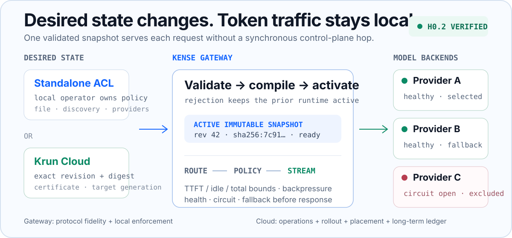

# krun-gateway

## 概述

krun Gateway 是模型 Provider 的统一流量入口，负责协议路由、访问控制、流式响应、健康检查和本地策略执行。

## 安装

```bash
brew install kense-labs/tap/krun-gateway
```

## 构建与验证

在 krun 仓库根目录执行：

```bash
cargo check --locked -p krun-gateway
cargo test --locked -p krun-gateway
```

With an OpenAI-compatible backend on `127.0.0.1:8000`, save this as
`gateway.acl`:

```acl
mode { kind = "standalone" }

entrypoints "web" {
  address = "127.0.0.1:8080"
}

routers "models" {
  rule        = "PathPrefix(`/v1`)"
  service     = "models"
  entrypoints = ["web"]
}

services "models" {
  load_balancer {
    strategy             = "least-connections"
    request_timeout      = "30s"
    stream_idle_timeout  = "5m"
    stream_total_timeout = "60m"
    servers = [{ url = "http://127.0.0.1:8000" }]
  }
}
```

Validate the complete snapshot before starting it:

```bash
krun-gateway validate --config gateway.acl
krun-gateway config --config gateway.acl summary
krun-gateway --config gateway.acl
curl http://127.0.0.1:8080/v1/models
```

## Why an AI traffic layer

| AI traffic requirement | Gateway mechanism |
| --- | --- |
| First-token and long-stream failure modes | Separate first-response, idle-stream, and total-operation bounds with backpressure and bounded drain |
| Model-specific access | Endpoint/model grants, alias rewriting, RPM, burst, concurrent-request admission, and local `tokens_per_minute` reservation via provisional `kense.gateway.tokenizer.v1` |
| Uneven or failing providers | Active/passive health, circuit state, weighted selection, failover, and retry only before a response starts |
| Safe policy changes | Validate and compile a complete snapshot, then atomically activate it; rejection keeps the previous runtime alive |
| Remote desired state | Apply complete Cloud snapshots while every authorized request decision stays local |
| Scale-to-zero workloads | Consume ready replica endpoints from Krun Box and release bounded requests only after the workload is routable |

This is intentionally narrower than an AI platform. Gateway does not own
tenants, deployment, placement, rollout, billing, model serving, or a human
operator UI.

## Architecture

<p align="center">
  
</p>

| Mode | Desired-state owner | Gateway responsibility |
| --- | --- | --- |
| `standalone` | Local operator and ACL | Validate and execute routes, middleware, providers, health, static revision weights, and opt-in scaling |
| `cloud-managed` | Krun Cloud | Validate and execute one complete identity-, revision-, digest-, CAS-, and expiry-bound snapshot |

Changing authority requires a process restart. Gateway exposes a machine-only
Node API for health, readiness, metrics, version, managed snapshot application,
exact snapshot status, and local usage-spool state.

### Gateway and Krun Box

Gateway and [Krun Box](https://github.com/kense-labs/krun) solve different parts
of one request lifecycle. Gateway owns admission, routing, health, and stream
fidelity. Box owns Sandbox workload state and publishes ready replica-slot
endpoints. In standalone mode, an opt-in Box executor can scale from zero,
atomically replace the live backend pool, release a bounded waiting request,
and withdraw an endpoint before Box drains and terminates its workload.

The integration has local, real-Gateway, real-Kubernetes, and exact-revision
real Linux Box Sandbox evidence. A real MicroVM workload gate remains open, so
standalone autoscaling is still experimental. Box is not called by
`cloud-managed` traffic; Cloud remains the desired-replica authority there.

## Capability status

| Area | Status | Current boundary |
| --- | --- | --- |
| Protocol and stream plane | Available | HTTP/1.1, HTTP/2, SSE, WebSocket, native gRPC over h2c, TCP, UDP, TLS, trailers, backpressure, independent stream bounds, and bounded drain |
| Routing, middleware, health | Available | Host/path/method/header rules for HTTP-family entrypoints; TCP entrypoints match pure `HostSNI(...)` rules after ClientHello peek, and skip that peek when the SNI table is empty so PathPrefix-only server-first TCP is not stalled. Built-in policies, typed Rust extensions, four balancing strategies, health, circuits, sticky sessions, failover, and mirroring |
| DNS service discovery | Removed | Unwired DNS helper deleted; ACL `providers` accepts only `file`, `discovery`, `kubernetes`, and `docker` |
| Traditional WAF | Unavailable | Not in product scope. Optional Cargo feature `wire` offers an agentfw-style LLM/MCP body firewall via `krun-sentry` (secret/PII masking on `/wire/<agent>/...`; request and response legs both honor `blocked()` / `fail_closed`); it is not an OWASP/ModSecurity WAF and is not part of the default data plane |
| Snapshot lifecycle | Available | Standalone ACL and Cloud-managed modes, fail-closed validation, listener reconciliation, atomic activation, exact readiness, and optional managed-state recovery |
| Managed target delivery (`H0.2`) | Verified jointly | Released Gateway plus pinned Cloud clean-host gates cover exact apply/ACK, process loss, redelivery, conflict/expiry rejection, certificate and target-generation replacement, replica-local readiness, and protocol compatibility |
| Managed Runtime Service routes | Gateway foundation + cross-platform real-process qualification | Embedded hosts can durably bind one exact loopback Runtime generation, verify health through the real Gateway route, hide admission, drain accepted streams (HTTP body, SSE, WebSocket, gRPC), remove only receipt-owned state, and recover the opaque binding identity after restart. Real OS-process evidence: lifecycle, restart/replay, plus SSE/WebSocket/gRPC drain-wait (`real_os_process_upstream_*` in `tests/managed_runtime_real_process.rs`). Host Krun Use/Code provider composition remains open outside this crate. |
| Managed OpenAI paths | Gateway foundation | Models, chat completions, completions, embeddings, grants, rewriting, admission, request/attempt identity, health-aware targets, pre-response fallback, and provisional tokenizer `kense.gateway.tokenizer.v1`; Cloud billing tokenizer and Power observation delivery remain EXIT-open |
| Native Gemini ingress | Gateway foundation | Native `gemini` targets on the existing native `wire = "openai"` surface, model-addressed JSON/SSE, distinct `gemini-generate` / `gemini-count-tokens` / `gemini-models` grants, Google credential/error shapes, bounded JSON and unbilled counters. Native loopback and official SDK checks pass; Studio production projection and Cloud usage contracts remain open. Spool-bound generation and principal routes refuse. |
| Upstream TLS trust | Available | Per-service `load_balancer.tls_ca_file` replaces webpki roots for HTTPS backends (PEM must parse; at least one `https://` server required). No production skip-verify path. |
| Distributed inference routing | Gateway/Power data plane | Aggregated dispatch plus distinct prefill/decode pair selection, authenticated profile-bound Power orchestration, opaque state-handle relay, OpenAI JSON/SSE translation, bounded cleanup, pair fallback, and Gateway-local rolling-version conformance; Cloud publication and cross-product qualification remain open |
| Usage delivery | Gateway foundation | Prompt-free bounded spool, integrity, restart recovery, ordered replay, contiguous acknowledgement, reclamation, compaction, frozen Cloud batch/ACK contract, HTTP bearer transport, and optional bootstrap uploader pairing (`docs/usage-cloud-ingest.md`); Cloud ledger ingest and joint crash/replay evidence remain open |
| Static object target (`WEB0.4`) | Gateway foundation | Path normalize, sealed manifest, `static_bundles` ACL, middleware-then-GET/HEAD dispatch, SPA eligibility, bounded admitted cache, ETag/If-Range/Range, snapshot drain, and standalone `local_digest_store` required at validate (`docs/static-object-target.md`); cloud-managed rejects bundles until Cloud `WEB0.1` |
| Standalone autoscaling | Experimental | Box and Kubernetes recovery evidence exists; real MicroVM workload conformance remains open |
| Automatic gradual rollout | Unavailable | `rollout {}` is rejected; managed rollout is a Cloud decision |
| Multimodal adaptation for text models | Design only | Native multimodal upstream content passes through unchanged. VLM/OCR/ASR-to-text adaptation is proposed, not shipped in v1.1.0 |

Read the exact [E0/H0.2 conformance record](docs/cloud-managed-e0-conformance.md)
the [distributed inference routing contract](docs/distributed-inference-routing.md),
and the [complete maturity roadmap](ROADMAP.md). “Available” means shipped;
“Verified jointly” names cross-repository evidence; “Foundation” still has
cross-product work; “Experimental” remains opt-in.

## Multimodal inputs and text-only models

The Gateway can already preserve OpenAI multimodal content for an upstream
that natively supports it. Making a text-only target consume the same request
would require an explicit, lossy preprocessing layer:

```text
image / audio / video -> bounded VLM / OCR / ASR -> provenance-bearing text -> text LLM
```

That can make a text model **multimodal-assisted**; it cannot make the model
intrinsically multimodal. The design learned from Qwen-MM-Plugins, the correct
native-inference insertion point, SSRF and prompt-injection controls, real TTFT
accounting, failure semantics, and a broad evaluation matrix are documented in
[the multimodal adaptation proposal](docs/multimodal-adaptation.md). No adapter
is enabled in v1.1.0.

## Performance beyond AI traffic

The reproducible same-host suite also alternates Kense Gateway and NGINX across
HTTP/1.1, HTTPS, HTTP/2, gRPC, SSE, WebSocket, TCP, UDP, OpenAI JSON, and OpenAI
streaming. It publishes throughput plus average, P50, P90, and P99 latency for
every raw trial. These profiles test protocol regressions; the token-aware lane
above is the primary model-traffic evidence.

[Published matrix](https://kense-labs.github.io/gateway/#performance) ·
[protocol comparison JSON](website/assets/performance-comparison.json) ·
[Criterion JSON](website/assets/performance-data.json) ·
[methodology](benchmarks/README.md)

## Deploy or embed

Docker:

```bash
docker run --rm \
  -v "$PWD/gateway.acl:/etc/gateway/gateway.acl:ro" \
  -p 8080:8080 \
  ghcr.io/kense-labs/gateway:latest \
  --config /etc/gateway/gateway.acl
```

Helm:

```bash
helm install gateway deploy/helm/krun-gateway \
  --set image.repository=ghcr.io/kense-labs/gateway \
  --set-file config=./gateway.acl
```

Rust library:

```bash
cargo add krun-gateway
```

Optional Cargo features:

| Feature | Adds |
| --- | --- |
| `redis` | Redis-backed distributed rate limiting |
| `kube` | Kubernetes Ingress provider and Scale executor |
| `wire` | Inline LLM/MCP secret and PII inspection through `krun-sentry` (request + response `blocked()`) |

Embedded Rust deployments can also register typed request/response middleware
through `MiddlewareRegistry`; the standalone binary does not load dynamic
libraries or Wasm plugins. See the
[middleware guide](https://kense-labs.github.io/gateway/docs/#middleware).

Embedded Krun hosts can additionally construct Gateway with an absolute private
Managed Service state file. The programmatic lifecycle binds only loopback
Runtime upstreams to a cleartext loopback HTTP entrypoint, keeps the operator or
Cloud ACL as the base desired state, and persists the overlay before changing
the live route. See the [Managed Runtime Service lifecycle](docs/managed-runtime-services.md)
for the exact bind, health, drain, removal, replay, and recovery contract.

## Development

Rust 1.88 or newer is required.

```bash
cargo fmt --all -- --check
cargo clippy --locked --all-targets -- -D warnings
cargo test --locked
bash scripts/test-install.sh
python website/scripts/check_site.py
node --check website/app.js
node --check website/docs/docs.js
```

## Documentation and license

- [Product website](https://kense-labs.github.io/gateway/)
- [Stable documentation](https://kense-labs.github.io/gateway/docs/)
- [Development documentation](https://kense-labs.github.io/gateway/docs/next/)
- [Release process](RELEASING.md)
- [Changelog](CHANGELOG.md)
- [Roadmap](ROADMAP.md)
- [Distributed inference routing](docs/distributed-inference-routing.md)
- [Static object target](docs/static-object-target.md)

Licensed under the [MIT License](LICENSE).
