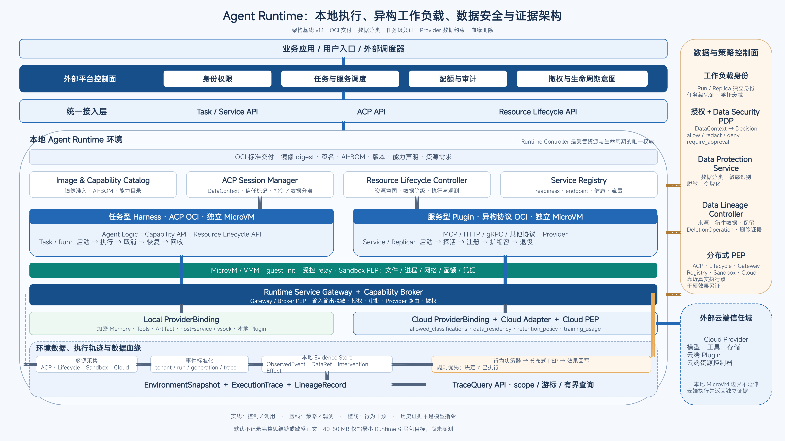

# Agent Runtime：本地执行、异构工作负载、数据安全与证据架构

> 历史方案，已停止作为实施依据。当前执行资源与调用方的职责见 [本地引擎边界](local-engine.md)。应用装配由调用方负责。

**版本**：v1.1 架构基线

**状态**：目标架构提案，尚未实现与联调



## 1. 架构边界

Agent Runtime 纯本地运行。Runtime 承载 ACP Harness 和异构 Plugin，提供资源生命周期、服务访问、沙箱隔离、数据安全、授权干预和证据查询能力。

```text
Harness = ACP OCI 工作负载＋Agent Logic
Plugin  = OCI 服务＋协议端点＋Provider 能力

本地 Agent Runtime 环境 =
  北向 API
  ＋运行控制面
  ＋沙箱执行面
  ＋能力数据面
  ＋数据与策略控制面
  ＋本地 Provider 与 Cloud Adapter
  ＋证据平面

外部系统 =
  业务应用／用户入口＋平台控制面＋Cloud Provider＋云端资源控制器
```

本地 Agent Runtime 环境包含控制器、工作负载、沙箱、本地 Provider、Cloud Adapter 和本地证据存储。Runtime Controller 是环境内的控制组件集合。

Runtime Controller 是受管资源所有权与实际生命周期的唯一权威。Harness 只能提交资源意图，不能直接操作宿主进程、挂载、网络、端口或 Plugin 实例。

### 1.1 架构约束

1. 新增 Harness 或 Plugin 只增加符合合同的 OCI 镜像。
2. 新增 Provider 只增加 ProviderBinding 或适配器。
3. 生命周期操作都经过 Resource Lifecycle Controller。
4. 能力调用都经过 Runtime Service Gateway 与 Capability Broker。
5. 数据安全决策集中在 PDP，实际执行留在分布式 PEP。
6. 云端是独立信任域，不继承本地 MicroVM 边界。
7. 观测事实、策略决定、实际干预和执行效果分别记录。
8. 证据查询结果是历史数据，不直接成为模型指令。

## 2. 运行分层

### 2.1 北向接入层

- **Task／Service API**：提交 RunSpec、Deploy、Scale、Rollout 和 Cancel。
- **ACP API**：处理版本协商、prompt、权限请求、取消和事件。
- **Resource Lifecycle API**：提交资源意图并查询 Operation 和 ResourceObservation。
- **TraceQuery API**：查询脱敏后的 EnvironmentSnapshot、ExecutionTrace 和 LineageRecord。

API 在入口校验身份、租户、请求大小和 schema，内部传递强类型值。

### 2.2 运行控制面

#### ACP Session Manager

管理 ACP 会话、prompt、权限请求、取消和事件转换。每个 session 绑定一个 RunBinding，旧执行代次不能复用会话。

ACP Session PEP 在入口创建 DataContext，标记数据来源和信任级别。网页、文档、邮件和工具输出默认作为不可信数据，不进入指令通道。

#### Resource Lifecycle Controller

管理 Harness、Plugin、Sandbox、Volume、Network、Endpoint、Checkpoint、Memory 和 Secret Reference。

控制器校验身份、权限、配额、镜像、数据等级、策略和执行代次，并负责幂等、超时、回滚、审计和状态对账。

API 接收成功不代表生命周期完成。调用方以 ResourceObservation 判断实际状态。

#### Image and Capability Catalog

保存 HarnessImageManifest、PluginImageManifest、AI-BOM、镜像 digest、签名、协议、能力声明、资源需求和健康要求。

声明只描述需求，不授予权限。每次 Run 或 Service 固定镜像、依赖和目录版本。

#### Service Registry

保存 service／replica／endpoint、协议、版本、健康状态、执行代次和流量份额。readiness 通过后才注册，liveness 失败后停止接收新流量。

### 2.3 沙箱执行面

每个 Harness 或 Plugin Replica 默认使用独立 MicroVM。沙箱提供独立客体内核、OCI rootfs、显式挂载、受控网络、Secret 引用、取消和资源回收。

Sandbox／guest-init PEP 在独立内核 MicroVM 内按 DataSecurityDecision 限制文件、进程、exec、挂载和网络出口。Box 产品路径不包含共享宿主内核隔离；进程命令沙箱见 [ksandbox](https://github.com/kense-labs/ksandbox)。

### 2.4 能力数据面

Runtime Service Gateway 提供服务发现、协议适配、配额、限流、超时、背压、错误归一化、凭据代理和取消传播。

Capability Broker 按能力 schema、数据等级、策略、健康状态和 ProviderBinding 选择 Provider。Gateway／Broker PEP 执行脱敏、拒绝、限流、审批和撤权。

Provider 不可用或授权失效时停止路由。Broker 不静默切换到更高权限或不同数据驻留区域的 Provider。

### 2.5 分布式 PEP

| PEP | 数据安全与干预动作 |
| --- | --- |
| ACP Session PEP | 标记信任级别、隔离外部数据、脱敏、拒绝会话、取消 prompt |
| Lifecycle PEP | 限制挂载和资源创建、停止、回滚、删除、拒绝恢复 |
| Gateway／Broker PEP | 输入输出脱敏、拒绝调用、限流、审批、撤销能力和凭据 |
| Registry PEP | 移除 endpoint、摘除 Replica、禁止未准入版本 |
| Sandbox／guest-init PEP | 断网、限制挂载或 exec、停止 MicroVM、终止客体进程 |
| Cloud Adapter PEP | 执行云端数据约束、撤权、停止、回滚并接收回执 |

## 3. 数据安全控制面

### 3.1 组件

#### Data Security PDP

根据身份、任务、目的、数据等级、目标 Provider、委托链和上下文计算决策。PDP 不直接修改数据或资源。

#### Data Protection Service

提供数据分类、敏感字段识别、脱敏和令牌化。注入检测和内容识别作为辅助信号，确定性授权仍由 PDP 和 PEP 完成。

#### Data Lineage Controller

保存源数据与衍生数据关系，执行保留、删除和删除证据对账。删除操作通过 Lifecycle Controller 和各 Provider 实际执行。

### 3.2 数据分类

| 类别 | 示例 | 必要控制 |
| --- | --- | --- |
| 源数据 | 文档、邮件、业务记录、用户输入 | 来源、分类、驻留、保留和删除 |
| 衍生数据 | 摘要、嵌入、索引、特征 | 来源血缘和级联删除 |
| 模型工件 | 模型、适配器、评估数据 | 签名、版本、准入和驻留 |
| 运行时数据 | prompt、上下文、工具输入输出、缓存 | 信任标记、脱敏、TTL 和出网限制 |
| 运维数据 | 日志、指标、审计、证据 | 最小化、脱敏、保留和访问控制 |
| Agent 状态 | 记忆、检查点、会话、计划、产物 | 加密、来源、版本、恢复和删除 |

### 3.3 DataContext

数据入口创建 DataContext，后续 PEP 使用同一强类型上下文。新的外部内容创建新的 DataContext。

```yaml
DataContext:
  tenant: tenant-id
  actor: user-or-workload-identity
  run: run-id
  generation: execution-generation
  purpose: declared-purpose
  data_refs: [data-ref]
  classifications: [public, internal, confidential, restricted]
  source_trust: trusted | untrusted | quarantined
  destination: capability-or-provider
  delegation_chain: [attenuated-grant]
```

### 3.4 DataSecurityDecision

```yaml
DataSecurityDecision:
  effect: allow | redact | deny | require_approval
  obligations:
    - local_only
    - encrypt
    - no_log
    - no_training
    - retain_for
    - revoke_after_run
  policy_version: policy-version
```

PEP 执行 effect 和 obligations。`redact` 必须产生实际脱敏结果。`require_approval` 必须绑定请求摘要、数据等级、Provider 和执行代次。

### 3.5 身份、凭证与委托

为 Harness、Plugin、Run 和 Replica 分配可验证身份。凭证绑定以下范围：

```text
发起人 × Run × Capability × DataRef × Generation
```

凭证按任务签发并在任务结束后失效。委托权限取交集，不沿委托链累加。真实密钥只进入受控 Resolver，不进入 prompt、记忆、日志或证据。

### 3.6 记忆与状态保护

Memory Provider 和 Checkpoint Provider 必须支持：

- 按租户加密和独立密钥引用。
- 保存来源、信任级别和版本。
- 隔离不可信写入。
- 按版本恢复或回滚。
- 按用户和来源删除。
- 按数据等级禁止出网。

长期记忆禁止直接接受网页、邮件或工具输出中的指令。

### 3.7 Provider 数据约束

ProviderBinding 增加以下字段：

```text
allowed_classifications
data_residency
retention_policy
training_usage
encryption_profile
attestation_requirement
```

Broker 在选择 Provider 前校验这些字段。`local_only` 数据不能因本地能力不可用而切换到云端。

TEE 和远程证明用于特定云端高敏场景，不替代路由授权、最小化和删除。

### 3.8 数据血缘与删除

Data Lineage Controller 管理以下关系：

```text
源数据 → 摘要／嵌入／索引 → 记忆／检查点／产物 → 缓存／日志引用
```

删除请求生成 DeletionOperation。各 Provider 返回实际删除结果。删除结果未知时先查询，不重复扩大删除范围。

审计记录按保留策略保存必要元数据，不默认保留被删除正文。

### 3.9 供应链安全

AI-BOM 记录 Harness、Plugin、模型、工具、Skill 和依赖的来源及 digest。镜像准入校验签名和版本。

工具描述扫描用于发现可疑内容，不替代权限交集、沙箱隔离和调用前授权。

## 4. 运行链路

| 链路 | 路径 |
| --- | --- |
| 控制流 | 平台／API → Controller → Sandbox → 工作负载 |
| 资源意图流 | Harness → Lifecycle Controller → Plugin／Volume／Network／Memory |
| 能力数据流 | Harness／Plugin → PEP → Gateway／Broker → Provider |
| 数据安全流 | DataContext → Data Security PDP → PEP → 实际结果 |
| 观测干预流 | 事件源 → 证据平面 → 行为决策器 → PEP → 效果回写 |
| 删除流 | 删除请求 → Lineage Controller → Lifecycle／Provider → 删除证据 |

TraceQuery 只读取证据投影，不参与执行控制。

## 5. 观测、干预与证据

### 5.1 观测边界

非侵入式观测不要求修改 Harness 业务代码。客体内部文件、进程和系统调用仍需要 guest-init 或 VMM 钩子。TLS 正文只有显式授权的中介才能读取。云端可见性取决于云端接口和回执。

### 5.2 事件合同

ObservedEvent 至少包含：

- schema、event_id、trace_id、span_id、parent_span_id；
- tenant／task／run／attempt／service／replica／generation；
- 来源、协议、操作、时间、持续时间和结果；
- 镜像 digest、能力目录版本和策略版本；
- DataRef、分类、目的和 ProviderBinding 引用；
- 载荷摘要、大小和截断标记。

事件默认不记录完整思维链、原始 prompt、真实 Secret 或敏感正文。

### 5.3 决策和执行证据

授权 PDP 在请求路径上同步计算准入。Data Security PDP 计算数据访问决策。行为决策器根据观测事件产生干预决定。

每个 Intervention 记录目标、generation、决定、执行点、动作、结果和证据。PEP 执行结果作为新的 ObservedEvent 回写：

```text
ObservedEvent → Decision → Intervention → PEP Result → ObservedEvent
```

Decision.block 不能证明实际拒绝已经发生。

### 5.4 证据投影

- **EnvironmentSnapshot**：Runtime、节点、镜像、沙箱、资源、网络、ProviderBinding 和策略版本。
- **ExecutionTrace**：Task、ACP Session、Resource Operation、Capability Call、Provider、Artifact 和 Cleanup 的执行 DAG。
- **LineageRecord**：DataRef、来源、衍生关系、保留状态和删除证据。

TraceQuery 按租户、Run、DataRef 和 scope 脱敏，使用游标和大小限制。

## 6. 接口合同

| 合同 | 内容 |
| --- | --- |
| HarnessImageManifest | ACP 版本、镜像 digest、AI-BOM、能力、资源、网络和 Secret 引用 |
| PluginImageManifest | 协议、能力、AI-BOM、资源、健康检查、endpoint 和 rollout |
| RunBinding | task／run／attempt、ACP session、Harness digest、代次、工作区和策略版本 |
| ServiceBinding | service／replica／endpoint、Plugin digest、协议、代次、健康和流量份额 |
| ProviderBinding | Local／Cloud、信任域、数据等级、驻留、保留、训练使用、配额和凭据 |
| DataRef | 数据标识、分类、来源、驻留、保留和删除根引用 |
| DataContext | 身份、任务、目的、DataRef、信任级别、目标和委托链 |
| DataSecurityDecision | effect、obligations 和 policy_version |
| ResourceSpec | 期望资源状态 |
| Operation | 生命周期操作 |
| ResourceObservation | 实际资源状态 |
| ApprovalGrant | 请求摘要、数据等级、Provider、代次、审批人和有效期 |
| LineageRecord | 来源、衍生关系、保留和删除状态 |
| DeletionOperation | 删除范围、执行状态和各 Provider 回执 |
| ObservedEvent | 已观测事实 |
| Decision | 授权、数据安全或行为判定 |
| Intervention | 实际干预、执行点、结果和效果证据 |
| EnvironmentSnapshot | 环境事实快照 |
| ExecutionTrace | 执行轨迹 DAG |
| TraceQuery | 有界、脱敏的证据查询 |

## 7. 故障与恢复

| 场景 | 处理 |
| --- | --- |
| ACP 提交响应丢失 | 使用原提交键查询，不自动重跑写入任务 |
| Harness 进程退出 | 按能力选择同代次恢复或新 attempt |
| Plugin readiness 失败 | 不注册、不接流量 |
| Plugin liveness 失败 | 停止新流量并替换 Replica |
| Provider 数据约束不满足 | 拒绝路由，不降级数据等级 |
| 云端不可用 | 本地资源继续运行，云端能力标记不可用 |
| 干预结果未知 | 查询实际执行点，不把 Decision 当作已执行 |
| 删除结果未知 | 查询各 Provider，不重复扩大删除范围 |
| 控制面重启 | 核对代次、endpoint、授权、干预和删除状态 |

取消后禁止出现晚写。恢复后旧代次禁止写入。回收后禁止残留受管资源。

## 8. 实施顺序

### 阶段 A：合同与确定性控制

定义 DataRef、DataContext、DataSecurityDecision、ProviderBinding、ApprovalGrant 和 LineageRecord。实现工作负载身份、短期凭证、委托衰减和分布式 PEP。

### 阶段 B：执行底座

实现 OCI 工作负载、ACP Session Manager、Lifecycle Controller、MicroVM、Service Registry、Gateway 和 Broker。

### 阶段 C：数据安全

实现 Data Security PDP、Data Protection Service、Memory 保护、Provider 数据约束、AI-BOM 和人工审批。

### 阶段 D：血缘、证据与删除

实现 Data Lineage Controller、DeletionOperation、EnvironmentSnapshot、ExecutionTrace、TraceQuery 和脱敏投影。

## 9. 验收标准

- 新增 Harness 或 Plugin 只增加 OCI 镜像，不修改 Runtime。
- 新增 Provider 不修改 Harness。
- Harness 不能绕过 Runtime 直接操作宿主资源。
- 受限数据不能路由到不满足等级、驻留或保留要求的 Provider。
- 委托后的权限不超过委托前权限。
- 不可信内容不能直接进入长期记忆或指令通道。
- 删除源数据后能查询衍生数据的实际删除结果。
- 每个干预都能关联决定、执行点和实际效果。
- 真实 Secret、完整思维链和敏感正文不进入默认事件记录。
- 取消后无晚写，恢复后旧代次不能写入，回收后无受管资源残留。

## 10. 交付体积

40–50 MB 仅指最小 Runtime 引导包的压缩体积目标，不包含 Harness 或 Plugin 镜像、客体内核、rootfs、模型、索引和缓存。该目标尚未经过最终制品测量。
