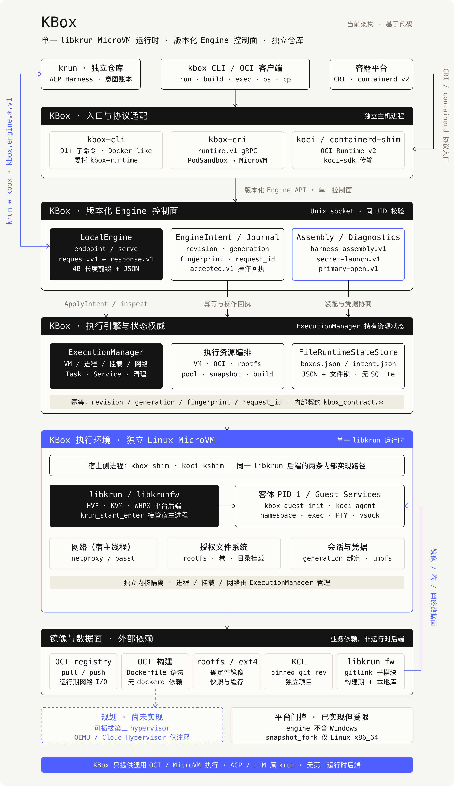

# KBox 当前架构

状态：**基于代码的当前架构**，2026-11-12，核对基线 `405c8b8`。本文只描述代码中已实现的结构；规划能力在图中以虚线框标注，不构成交付声明。

图按 Kense OS 工程蓝图风格绘制：风格单一真源是 krun 仓库的 `docs/architecture/krun-architecture.svg`（源自 `kstack/docs/architecture/kense-os-modules.html`）。[矢量原图](kbox-architecture.svg)

## 图例

| 视觉元素 | 含义 |
| --- | --- |
| 米白底 `#F8F6F0` + 黑色分区标题条 | Kense OS 蓝图基础版式 |
| 等宽字 `Menlo / PingFang SC`、蓝色 `#4E60FF` 强调 | 同一风格规范 |
| 深色实心块 | 状态或资源的权威持有者 |
| 蓝色边框分区 | 执行环境边界 |
| 侧边旋转通道标注 | 跨仓库 / 跨边界通道 |
| 蓝色连线 | 版本化 wire 或数据面 |
| **蓝色虚线框** | **规划 · 尚未实现** |
| 灰色实线框（平台门控） | 代码存在但受 `cfg` / 平台限制 |

## 权威顺序

代码 > `scripts/` 声明式契约 > `docs/evidence/**` > 架构文档 > README。`AGENTS.md` 明确 "Planning is not acceptance evidence"；`specs/`、`docs/architecture/` 中的目标描述不能当作已实现能力。本图与 `krun` 仓库那张「目标架构」图的性质不同：那张是目标设计，这张是当前代码事实。

## 分层说明

| 区域 | 主要组件 | 代码位置 | 状态 |
| --- | --- | --- | --- |
| 外部调用方 | krun（独立仓库）、kbox CLI、CRI / containerd | `crates/box/cli`、`crates/box/cri`、`crates/oci-runtime/crates/containerd-shim` | 已实现 |
| 入口与协议适配 | `kbox-cli`、`kbox-cri`（`runtime.v1` gRPC）、`koci` / `containerd-shim-koci-v2` | `crates/box/cli/src/main.rs`、`crates/box/cri/src/lib.rs`、`crates/oci-runtime/crates/cli/src/main.rs` | 已实现 |
| Engine 控制面 | `LocalEngine`、Unix socket + 4 字节长度前缀 + JSON、`EngineIntent` / `EngineJournal`、Assembly / Diagnostics | `crates/box/runtime/src/engine/{controller,transport,protocol,journal,assembly}.rs` | 已实现（仅 Linux / macOS） |
| 执行引擎与状态权威 | `ExecutionManager`、VM / OCI / rootfs / pool、`FileRuntimeStateStore` | `crates/box/runtime/src/local_execution/`、`crates/runtime/src/state/file.rs` | 已实现 |
| 执行环境 | `kbox-shim` / `koci-kshim` → `libkrun` / `libkrunfw` → `kbox-guest-init` / `koci-agent` | `crates/box/shim/src/vm_launch.rs`、`crates/oci-runtime/crates/kbox/`、`crates/box/guest/init/` | 已实现 |
| 镜像与数据面 | OCI registry、自研 OCI 构建、rootfs / ext4、KCL、libkrunfw | `crates/box/runtime/src/oci/`、`crates/box/third_party/mkext4/`、根 `Cargo.toml` | 已实现 |
| 规划 / 门控 | 可插拔第二 hypervisor、Windows engine、跨平台 snapshot_fork | `crates/box/core/src/vmm.rs`、`crates/box/runtime/src/vm/mod.rs` | 规划未实现 / 平台受限 |

## 关键边界（容易画错的地方）

1. **只有一个虚拟化后端**：`VmBackend::{Kbox, Whpx}` 都经 libkrun。`kbox-shim` 与 `koci-kshim` 是同一后端下两条内部宿主进程实现（迁移 / 验收 seam），不是两个可并列切换的「运行时后端」，路由器也不会失败后自动降级。QEMU / Cloud Hypervisor 只出现在 `VmmProvider` 的文档注释里，没有实现。
2. **ACP 与 LLM 在 kbox 之外**：`agent-client-protocol` / `rmcp` 只出现在 `[workspace.dependencies]`，未进入 `Cargo.lock`；kbox 侧只有 `EngineWorkload::AcpHarness` 这个工作负载分类枚举。Harness、ACP Session Manager、模型路由属于 krun。
3. **kbox 与 krun 是独立仓库**，无共享 crate；唯一的耦合是 `scripts/wire-contracts.json` 中的字符串契约与两侧同步的 KCL `git rev`。
4. **状态不是 SQLite**：`rusqlite` 只在根 `[workspace.dependencies]` 声明，全库无使用；状态是 `boxes.json`、`engine/intent.json`、`engine/runtime/` 的 JSON 文件加文件锁。
5. **Docker / BuildKit 不是运行时依赖**：全库无 `dockerd` / `docker.sock` / `buildkitd` 调用，只有自实现的 Dockerfile / BuildKit 语法子集与 OCI registry 客户端；它们属于数据面。
6. **CRI 与 containerd shim 是协议适配层**，不是虚拟化后端，最终仍落到 libkrun MicroVM。
7. **libkrun / libkrunfw 是 gitlink submodule**，构建期编译、运行期本地动态库链接；既不是 Cargo 依赖，也不是网络服务。
8. **Windows 不编译 engine 控制面**（`#[cfg(all(feature = "pool", any(target_os = "linux", target_os = "macos")))]`）；`snapshot_fork` 仅 Linux x86_64 KVM；WHPX 有 1 vCPU 等限制。这些是平台门控，不画成「已全平台可用」，也不与「规划未实现」混为一谈。
9. `kbox.engine.journal.v1` / `kbox.engine.prewarm.v1` 是 kbox 内部 schema，从不发给 krun；`kbox_contract.*`、`kbox.build-*.v1`、`koci.*.v1` 也都不是 krun ↔ kbox wire。
10. `kbox-runtime` 的 3 个 `[[example]]` 是平台验收示例，不是产品二进制；`h2` 自带 workspace、`oci-spec-0.10.0` 是 `[patch.crates-io]` 目标，都不算第 20 / 21 个 member。

## 事实来源

- 根 `Cargo.toml`（19 个 workspace members、lint 基线、KCL pinned rev、`[patch.crates-io]`）与 `Cargo.lock`。
- `scripts/wire-contracts.json`、`scripts/check-wire-contracts.py`、`scripts/check-kcl-source.py`、`scripts/check-workspace-layout.py`。
- `crates/box/runtime/src/engine/protocol.rs` 的 `EngineIntent` / `EngineCommand` 与幂等键定义。
- `crates/box/core/src/platform.rs` 的 `HostFamily` / `VmBackend` / `PlatformCapabilities`。
- `crates/oci-runtime/crates/kbox/src/lib.rs` 关于「主运行时、CLI、SDK 不链接 libkrun」的边界声明。

## 本图不声明

- 不声明第二 hypervisor、后端切换或自动降级已实现。
- 不声明 Windows 上 engine 控制面、跨平台 snapshot_fork 或完整 WHPX 能力矩阵可用。
- 不声明任何原生运行时性能、平台验收结果或端到端行为；本轮未运行 VM、ACP 或 e2e 测试。
- 不声明 ACP / LLM 能力属于 kbox。
- 新增文件未提交、未推送；`krun` 仓库的并行未提交改动未被触碰。
