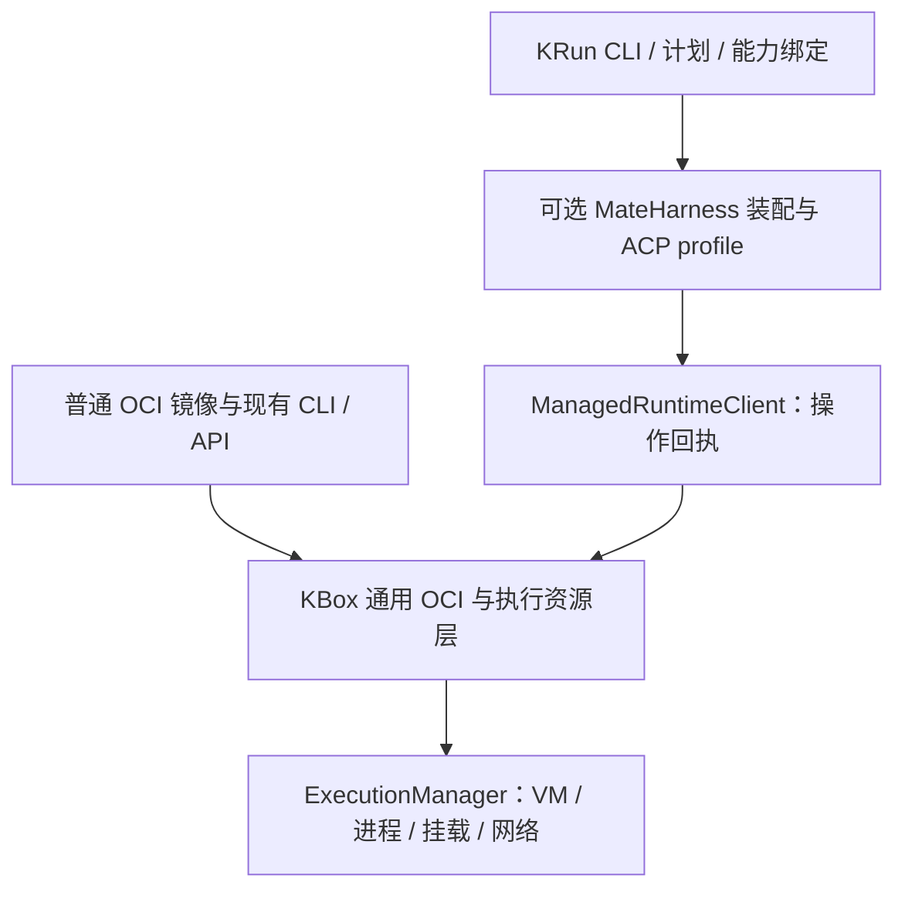

# kbox 与独立 KRun 的集成边界

状态：架构与分阶段实施，2026-11-11；实际完成范围以证据为准。

KRun 使用独立目录和仓库 `git@github.com:kense-labs/krun.git`，标识为 `krun`。主架构和命令合同由 KRun 仓库维护：

- [本地配套工作区的 KRun 架构](../../../krun/docs/architecture.md)
- [本地配套工作区的 CLI 合同](../../../krun/docs/cli.md)
- [本地配套工作区的实施计划](../../../krun/docs/implementation-plan.md)
- [kbox 引擎有界实施 spec](../../specs/001-krun-engine/spec.md)
- 远端仓库：https://github.com/kense-labs/krun

kbox 提供执行后端：

**kbox 的通用 OCI 能力保持独立。** 现有镜像拉取／构建／运行、普通进程、exec、卷、网络、快照及其生命周期 API 不要求 ACP、Harness 安装包或 KRun。KRun 是其上层客户与运行 profile；MateHarness 是可选装配模块。ACP 和独立内核约束只应用于 Harness profile，不收窄普通 OCI 数据合同或默认能力。

能力发现和协议验收分开进行。普通 OCI 不需要 Harness 包或 ACP；
Directory 等通用扩展也可由 OCI 调用方显式授权使用。原有
Artifact 的只读保证不因可写 workspace 接入而放宽。KRun profile
仅选择所需扩展，不成为整个运行时的准入条件。

1. 按平台、KRun/能力摘要、资源、信任范围与启动挂载集合预热环境，池键不绑定 Harness ID。
2. MateHarness 作为装配模块校验并安装 ACP Harness 压缩包，准备 Run 私有文件系统和配置，交由 ExecutionManager 启动。
3. 提供无 PTY 的双向流式 ACP 通道；协议扩展、模型选择、工具与任务循环仍由 Harness 和真实 ACP Client 协商。
4. 管理 VM、进程、卷、网络、端点、凭据交付与实际清理；向 KRun 返回带 execution identity、generation 和证据的观测。
5. 通过版本化引擎接口与独立 KRun 集成，不依赖配套仓库的本机相对源码路径，不建立第二套执行状态机。

KRun 负责 CLI、实例意图、包与能力索引、依赖解析、绑定适配和运行基础制品。它读取 kbox 的实际观测，不自行推断 VM 存活。用户配置继续使用 KCL；清单、装配计划与回执是版本化数据合同。

Harness 第一版交付格式为 ZIP；`tar.zst` 待真实体积与安装性能比较后决定，无需每个 Harness 单独制作 OCI 镜像。安装包声明 ACP 入口、目标客体平台、版本与依赖；非 ACP 原生程序的 ACP adapter 放在包中。

独立 SDK 已接通持久意图、原始流、显式目录授权、MateHarness 流式装配、
兼容 VM 预热和内存凭据交付。三套实际 ZIP 通过共享底座和正式 KRun CLI
的 ACP 初始化、EOF、幂等启动和精确清理。仅安装 KBox 的原生回归通过拉取、
构建、运行、外部目录和卷、联网、导出、提交后重跑和快照恢复。
[装配与 OCI 实施证据](../evidence/engine/20261111-credential-bootstrap/OUTCOME.md)

原生认证刷新、通用依赖检测、完整 CLI 故障矩阵、五类能力和三套真实模型长程任务继续按 KRun 的实施计划验收。
[KRun 开发状态](../../../krun/docs/implementation-status.md)
