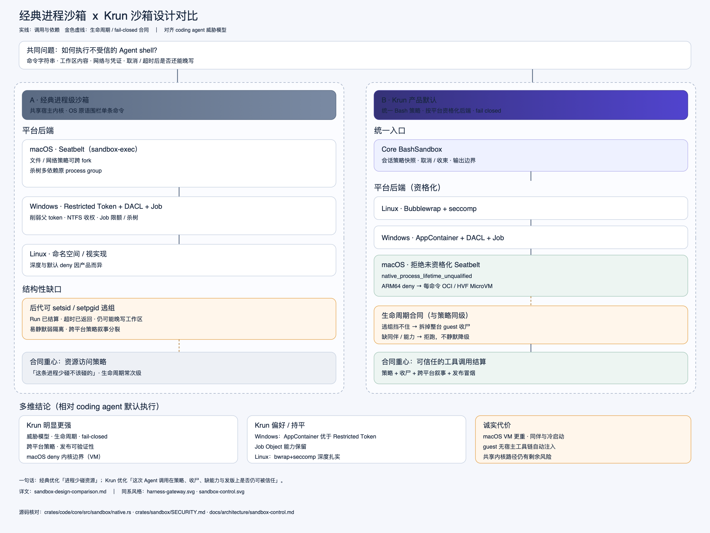

# Krun 沙箱设计对比报告

[对比图 PNG](sandbox-design-comparison.png) · [可编辑 SVG](sandbox-design-comparison.svg)



风格对齐 [多 Harness 协作架构](harness-gateway.svg) / [沙箱观测干预](sandbox-control.svg)：浅底、紫底协调条、白卡片、金色虚线表示合同约束。

**范围**：将「经典进程级沙箱」（macOS Seatbelt；Windows Restricted Token + NTFS DACL + Job Object；可选 Linux 命名空间）与 **Krun 产品默认路径**（`BashSandbox` → Linux bwrap+seccomp / Windows AppContainer+DACL+Job / macOS ARM64 deny → OCI HVF MicroVM）对照。

**核对来源（设计与代码，非性能实测）**：

- `docs/architecture/sandbox-control.md`
- `crates/sandbox/SECURITY.md`、`THREAT_MODEL.md`
- `crates/code/core/src/sandbox/native.rs`（`native_process_lifetime_unqualified`）
- `crates/code/manual/EVALUATION_SUBSTRATE.md`
- `AGENTS.md` / `tests/cli_sandbox_smoke.py` 发布门禁

**明确不宣称**：本报告不给出延迟、吞吐或「比 Seatbelt 快/慢 N%」的数字；不宣称已消除全部共享内核剩余风险；不把终端 `krun-sandbox` 与命令沙箱混为同一后端。

---

## 1. 对照对象

| 代号 | 含义 |
| --- | --- |
| **A-经典** | 进程级：共享宿主内核；macOS=`sandbox-exec`/Seatbelt；Windows=Restricted Token + DACL + Job；生命周期多依赖 process group / Job |
| **B-Krun** | 统一策略 + 按平台选后端；Core 在 macOS 上**拒绝**未资格化的原生 Seatbelt 命令路径，deny 默认升格为**每命令独立 Linux MicroVM**；Linux/Windows 用原生 OS 围栏且 fail closed |

Krun 的 `krun-cmd-sandbox` 库内**仍实现** Seatbelt；「更好」指的是 **Core 产品默认选择与资格化合同**，不是否定 Seatbelt 作为 OS 原语。

---

## 2. 威胁模型是否对齐 coding agent

| 维度 | A-经典 | B-Krun | 为何更贴 Krun 场景 |
| --- | --- | --- | --- |
| 不信任对象 | 常默认「这条命令」 | **命令字符串、后代、工作区内容、显式环境**（SECURITY.md） | Agent 会起 shell、包管理器、后台任务；只围根 shell 不够 |
| 成功合同 | 常看「退出码 + 策略未破」 | 另加：**取消/超时/结算后不得晚写**；不能证明后代已停则不得假装安全结束 | Agent Run 结算、验证门、证据链依赖「收尸」 |
| 缺能力时 | 易静默降级或半隔离 | **禁止静默无沙箱执行**；缺 bwrap/同伴则报错 | 避免「以为沙了其实没沙」的发布事故 |
| 策略面 | 常按 OS 各写一套 | **同一 baseline**（禁网、凭证路径、控制元数据、输出上限、杀树）再映射后端 | 产品行为跨平台可推理 |

**结论**：在「LLM 驱动、多后代、要可取消」的威胁模型下，Krun 把 **生命周期** 抬到与文件/网络策略同级；经典进程沙箱往往只资格化后两者。

---

## 3. 生命周期与后代包含（核心差异）

### 3.1 经典路径的结构性缺口（尤其 macOS）

- Seatbelt：**文件/网络策略可跨 fork 保留**。
- 杀树若只杀 **原 Unix process group**：子进程可 `setsid` / `setpgid` **脱离组**。
- 结果：Run 已返回、超时已触发，**逃逸后代仍可写工作区** → 假完成、假取消、污染后续验证。

Core 对此的产品反应不是「再调一调 Seatbelt profile」，而是：

```text
macOS NativeBashSandbox → 启动前拒绝（native_process_lifetime_unqualified）
macOS ARM64 + deny → OciBashSandbox（每命令独立 guest）
```

代码注释（`native.rs`）写明：在后代包含成为真实能力之前，不承认后台执行资格。

### 3.2 Krun 升格 VM 解决的是哪一类问题

| 问题 | Seatbelt+进程组 | MicroVM（每命令） |
| --- | --- | --- |
| 策略是否跟 fork | 通常是 | Guest 内任意进程仍在 guest 内 |
| 逃出 process group | 可能 | 逃不出 guest |
| 结算后收尸 | 依赖宿主杀树完备性 | **拆掉整机**即可结束客体副作用面 |
| 证明「无晚写」 | 难、易漏 | 客体销毁后仅显式挂载交接保留 |

**为何这算「更好」**：对 agent 而言，**错误的生命周期比略弱的文件策略更危险**——一次假成功就能进事实日志、开 PR、标 Verified。Krun 选择 **宁可拒绝原生路径，也不交付未资格化的「沙箱成功」**。

### 3.3 Windows 侧：同类问题、不同答案

| | Restricted Token + DACL + Job | Krun AppContainer + DACL + Job |
| --- | --- | --- |
| 身份 | 削弱后的父 token | **独立 AppContainer 包 SID** |
| 文件系统 | DACL 收权 | 命令期工作区 DACL + 临时 DOS 盘暴露；结束后快照还原 |
| 杀树/配额 | Job Object | **同样 Job Object**（kill-on-close 等） |
| Shell | 视实现 | **PowerShell 7**（5.1 在 AppContainer 下不安全，明确不用） |

Krun 并不「否认 Job Object」，而是用 **更容器化的身份模型** 降低「仍像父进程」的残留能力面，并与统一 baseline 对齐。

---

## 4. 隔离强度与剩余风险

摘自架构分层（进程命令 / 共享内核环境 / 独立内核 VM）：

| 边界 | A-经典（进程） | B-Krun 默认（按平台） |
| --- | --- | --- |
| 内核 | 共享宿主 | Linux/Win 共享；**macOS deny 命令默认客体内核** |
| 文件系统 | 策略允许的宿主路径 | 同左（原生）或 **显式挂载交接**（VM） |
| 网络 | 视 profile | Baseline **deny**；中介模式另证 |
| 剩余风险 | 共享内核 + 已授权宿主资源 + **杀树漏洞** | 原生路径仍有共享内核剩余；**VM 路径剩余转到 VMM/共享挂载/控制通道**（更窄、更可枚举） |

**更好之处**：Krun **按风险显式分层**，并在 macOS 把「未资格化的共享内核命令沙箱」从默认路径拿掉，而不是用同一套 Seatbelt 话术覆盖所有平台。

**诚实边界**：VM 不是绝对安全；同伴完整性、挂载面、VMM 缺陷仍在威胁模型内。发布依赖 `cli_sandbox_smoke.py` 等**已安装档案**验证，而不是 README 自称。

---

## 5. Fail-closed 与资格化文化

| 行为 | A-经典常见 | B-Krun |
| --- | --- | --- |
| 缺 `bwrap` / Seatbelt / AppContainer | 有时跳过隔离跑通测试 | **禁止静默弱隔离**（THREAT_MODEL / SECURITY） |
| macOS 生命周期未证 | 仍可能标「已沙箱」 | **稳定错误码 + 引导升级/yolo/装同伴** |
| 辅助超时 / drop future | 易当成「已停」 | 文档强调：**不等于后代已停**；宿主须在真实边界验证 |
| 发布 | 常靠开发机绿 | **macOS 归档须带齐 sandbox 同伴并通过安装前缀冒烟**（AGENTS.md） |

**更好之处**：把「沙箱」从营销标签变成 **可拒绝、可审计、可发布门禁的合同**。对商业 coding agent，这比「多数时候 Seatbelt 够用」更可运营。

---

## 6. 跨平台策略一致性

| | A-经典 | B-Krun |
| --- | --- | --- |
| 策略语言 | 三套 OS API 心智 | 一套 Krun Bash baseline → 后端编译 |
| 禁网默认 | 视产品 | 默认同向 deny（含 Unix socket） |
| 凭证/.git/.krun 等 | 易漏平台 | 写入统一安全模型并测 |
| 输出边界 | 常无限 | 捕获上限 + 观察者 |

**更好之处**：模型与宿主面对的是 **同一权限叙事**；平台差异收在适配器，而不是散落在 prompt「请小心 rm」。

---

## 7. 与观测 / 干预面的可组合性

Krun 架构把执行面（沙箱）与判定面（`krun-sentry`）、干预面（Gateway / Guard）分开：

- 沙箱负责 **能不能跑、跑在哪**；
- Sentry 负责 **风险判定**；
- 二者不互相替代（架构文明确写：观测不能代替执行入口隔离）。

经典纯 Seatbelt/Job 方案往往 **止于执行围栏**，缺少同级的「判定 ≠ 拒绝 ≠ 落地」拆分。

**更好之处**：适合多 Harness / Gateway 产品，而不是单机 IDE 插件级沙箱。

---

## 8. 多维度总评（为何说 Krun「更好」）

下列「更好」均相对于 **本地 coding agent 默认执行不受信 shell** 这一目标，而非通用 OS 加固排行榜。

| 维度 | 评分倾向 | 理由（短） |
| --- | --- | --- |
| 1. 威胁模型契合度 | Krun 明显更好 | 显式覆盖后代、晚写、凭证、控制元数据 |
| 2. 生命周期合同 | Krun 明显更好 | macOS 拒绝未资格化原生路径；VM 用销毁 guest 收尸 |
| 3. Fail-closed | Krun 明显更好 | 无静默降级；缺同伴即拒 |
| 4. 跨平台策略统一 | Krun 更好 | 一策略多后端 |
| 5. 内核边界（macOS deny） | Krun 更强 | 客体内核 vs 共享内核 Seatbelt |
| 6. Windows 身份面 | Krun 偏好 AppContainer | 比 Restricted Token 更「非父进程」；Job 能力不丢 |
| 7. Linux 深度 | Krun 扎实 | bwrap 命名空间 + seccomp baseline（非仅 rlimit） |
| 8. 发布可验证性 | Krun 更好 | 同伴清单 + 安装冒烟强制 Linux guest 等 oracle |
| 9. 冷启动 / 运维复杂度 | 经典往往更轻 | Krun macOS VM **更重**（诚实代价） |
| 10. 实现体量 | 经典更小 | Krun 换的是合同强度，不是 LOC 更少 |

**一句话定位**：经典进程沙箱优化的是「**这条进程少碰不该碰的资源**」；Krun 优化的是「**这次 Agent 工具调用在策略、收尸、缺能力、跨平台叙事上是否仍可被产品信任**」。在后者目标下，默认升格 VM（macOS）和拒绝未资格化 Seatbelt，是 debatable 的工程取舍中的 **正确优先级排序**：生命周期与 fail-closed 优先于轻量。

---

## 9. 代价与适用边界（避免神化）

Krun 设计 **更重、更贵、更难装**：

- macOS 需维护 OCI/krun 同伴与镜像；冷启动高于 `sandbox-exec`。
- 客体内无宿主工具链自动注入；解释器必须在 guest 中。
- 共享内核路径（Linux/Win）仍有内核逃逸等剩余风险，需威胁模型诚实标注。
- 显式 yolo / process-host / require_escalated 仍存在——那是 **授权升级**，不是默认。

若场景是「短命、无后台、可接受 process-group 残余」的内部工具，A-经典可能足够。  
若场景是 **Krun 这类会结算 Run、写证据、发版带沙箱承诺的 agent**，B-Krun 的默认更匹配责任边界。

---

## 10. 对照速查表

| 问题 | A-经典 | B-Krun 默认答案 |
| --- | --- | --- |
| macOS 用什么？ | Seatbelt | **拒绝 Seatbelt 命令资格** → **每命令 MicroVM**（ARM64 deny） |
| Windows 用什么？ | Restricted Token + DACL + Job | **AppContainer + DACL + Job**（非 Restricted Token） |
| Linux 用什么？ | 视实现 | **bwrap + seccomp** |
| 后代逃组怎么办？ | 常成残留洞 | macOS 用 VM 消灭宿主侧逃组面 |
| 没装好沙箱？ | 可能照跑 | **拒跑** |
| 如何证明给发布？ | 难统一 | 同伴 + `cli_sandbox_smoke.py` |

---

## 11. 修订记录

| 日期 | 说明 |
| --- | --- |
| 2026-11-04 | 初版：基于架构文与 Core 原生拒绝理由整理；无性能数字 |
| 2026-11-04 | 增补同系风格对比图 `sandbox-design-comparison.svg` / `.png` |
