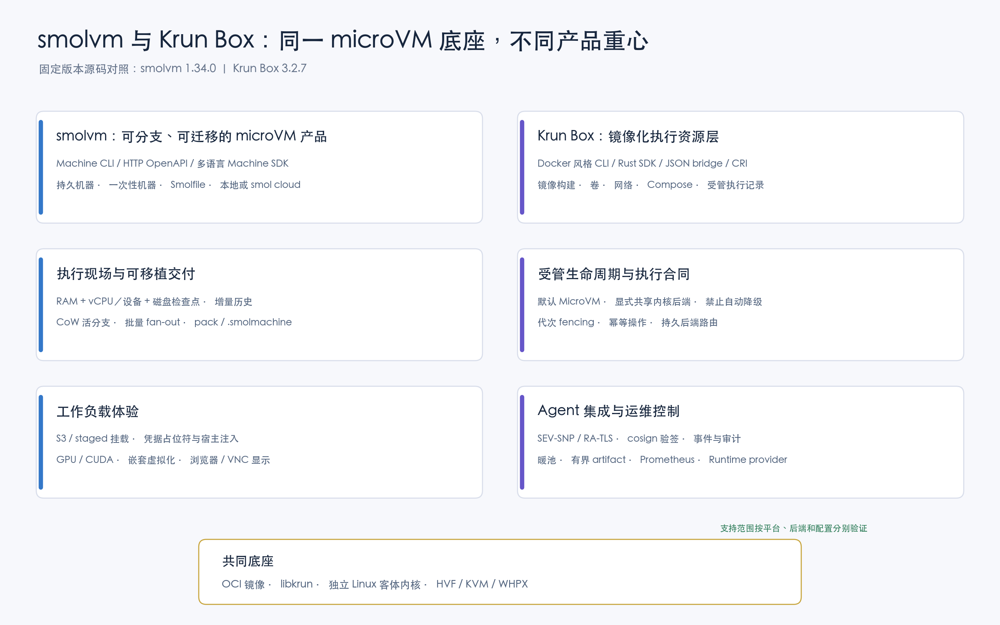

# smolvm 与 Krun Box 功能特性深度对比

> 对比对象：smolvm 主线固定提交 `8bdf626050837e44dd2fcc5c4008a0c435299091`（crate 1.34.0），以及当前工作区 Krun 提交 `0a987c7002afab52114dd89f1407d2d8ebe4af7d` 中的 Krun Box 3.2.7。smolvm 的固定提交来自 `main` 查询结果。[GitHub](kimi-cite://web?url=https%3A%2F%2Fapi.github.com%2Frepos%2Fsmol-machines%2Fsmolvm%2Fcommits%2Fmain&text=%22sha%22%3A%20%228bdf626050837e44dd2fcc5c4008a0c435299091%22 "citation") [smolvm](kimi-cite://web?url=https%3A%2F%2Fraw.githubusercontent.com%2Fsmol-machines%2Fsmolvm%2F8bdf626050837e44dd2fcc5c4008a0c435299091%2FCargo.toml&text=version%20%3D%20%221.34.0%22%0Aedition%20%3D%20%222021%22%0Adescription%20%3D%20%22OCI-native%20microVM%20runtime%22%0Alicense%20%3D%20%22Apache-2.0%22 "citation") [Cargo](kimi-cite://text?path=%2FUsers%2Froylin%2Fcode%2Faster%2Fcrates%2Fbox%2Fsdk%2FCargo.toml&text=name%20%3D%20%22aster-box-sdk%22%0Apublish%20%3D%20false%0Aversion%20%3D%20%223.2.7%22 "citation")
>
> 方法：以源码、命令定义、SDK 合同、运行时校验和测试为主，README 只作为入口证据。本文比较 **Krun Box**，不是把整个 Krun Core 的命令沙箱、Sentry、Gateway 或 Studio 功能都计入 Box。smolvm 的多语言 SDK 位于配套 `smol` 仓库，因此将其标为“配套生态”，不伪装成 smolvm 单仓库内文件。

## 执行摘要

**一句话结论：smolvm 更像“可分支、可迁移、可分发的通用 microVM 产品”，Krun Box 更像“面向 Krun Agent/云运行时的 Docker 化执行资源层”。** 两者都以 OCI 镜像、libkrun 和独立 Linux 客体内核为基础，也都覆盖 macOS HVF、Linux KVM、Windows WHPX；真正的差异不在“能不能启动 VM”，而在机器状态如何复制和交付、资源如何受管、以及安全与运维合同有多完整。[smolvm](kimi-cite://web?url=https%3A%2F%2Fraw.githubusercontent.com%2Fsmol-machines%2Fsmolvm%2F8bdf626050837e44dd2fcc5c4008a0c435299091%2FREADME.md&text=%5BHypervisor.framework%5D%28https%3A%2F%2Fdeveloper.apple.com%2Fdocumentation%2Fhypervisor%29%20%28macOS%29%2C%20KVM%20%28Linux%29%2C%20or%20the%20%5BWindows%20Hypervisor%20Platform%5D%28https%3A%2F%2Flearn.microsoft.com%2Fen-us%2Fvirtualization%2Fapi%2F%29%20%28Windows%29. "citation") [config](kimi-cite://text?path=%2FUsers%2Froylin%2Fcode%2Faster%2Fcrates%2Fbox%2Fcore%2Fsrc%2Fconfig.rs&text=MicroVM%20remains%20the%20implicit%20default.%20Host%20sandbox%20execution%20must%20always%20be%0A%2F%2F%2F%20selected%20explicitly%20by%20the%20caller%20and%20never%20acts%20as%20an%20automatic%20fallback. "citation")

如果目标是多分支 Agent、回滚到运行中现场、跨机继续执行、制作免安装 VM 包，**smolvm 明显领先**。如果目标是镜像构建、命名卷和网络、Compose、CRI、Rust 直接嵌入、幂等受管生命周期、SEV-SNP/RA-TLS、cosign 验签、审计与 Krun Runtime 集成，**Krun Box 更合适**。两者并非简单替代关系：smolvm 的全状态分支/检查点可以补 Krun Box 的状态复制短板，Krun Box 的受管执行合同和运维资源模型则不是 smolvm 的重点。

| 维度 | 更占优势者 | 核心原因 |
| --- | --- | --- |
| 全状态检查点、活分支、历史回溯 | **smolvm** | RAM、vCPU/设备、磁盘与进程现场；CoW 活分支；增量对象存储和历史 |
| 可移植应用交付 | **smolvm** | `.smolmachine`、stub、可选单文件可执行包、OCI registry 分发 |
| Docker 风格资源管理 | **Krun Box** | build/commit/tag/push/save/load/import、卷、网络、Compose、事件、prune |
| 隔离后端选择 | **Krun Box** | 默认 MicroVM，另可显式选择 Linux 共享内核 Sandbox，且禁止自动降级 |
| 生命周期一致性 | **Krun Box** | 代次 fencing、操作 ID、幂等重启、统一 ExecutionManager 和持久后端路由 |
| 凭据“可用不可读” | **smolvm** | 客体只有占位符，宿主按域名/方法/位置注入真实值 |
| TEE 与远程证明 | **Krun Box** | SEV-SNP、RA-TLS、报告验证、seal/unseal、秘密注入；TDX 未落地 |
| 文件与对象存储 | 各有优势 | smolvm 有 S3/staged；Box 有命名卷、tmpfs、幂等文件变更、有界 artifact |
| 网络策略 | smolvm 更易用，Box 更偏运行时 | smolvm 有域名/CIDR/私网/动态更新；Box 有 TSI/bridge/host/none、DNS 服务发现和 IPv4 L4 规则 |
| GPU、显示、嵌套虚拟化 | **smolvm** | Vulkan、CUDA remoting、浏览器/VNC、nested KVM；Box 明确拒绝 `--gpus` |
| 声明式与集群接口 | 场景不同 | smolvm 是 Smolfile＋containerd shim；Box 是 Compose ACL/YAML＋CRI |
| 可观测性与安全审计 | **Krun Box** | 结构化审计、事件流、Prometheus、运行时统计；smolvm 也有日志、指标和脱敏 usage journal |
| 公开分发与嵌入生态 | **smolvm** | Apache-2.0、安装渠道、Node/Python/Rust/Go Machine API；Box crate `publish = false` |

## 1. 架构与产品定位

### 1.1 共同底座相同，管理对象不同

smolvm 的基本管理对象是 **Machine**：一次性或持久命名机器，围绕 `run/create/start/exec/stop/delete` 组织，另加 `serve` 和 `pack`。Krun Box 的基本管理对象是 **Box/Execution**：既包括 VM、rootfs、工作负载，也包括持久执行记录、代次、资源、事件、镜像、卷和网络。前者围绕“机器及其状态”扩展，后者围绕“可受管执行环境及其资源所有权”扩展。[mod](kimi-cite://text?path=%2FUsers%2Froylin%2Fcode%2Faster%2Fcrates%2Fbox%2Fcli%2Fsrc%2Fcommands%2Fmod.rs&text=%2F%2F%2F%20Aster%20Box%20%E2%80%94%20Docker-like%20MicroVM%20runtime. "citation") [router](kimi-cite://text?path=%2FUsers%2Froylin%2Fcode%2Faster%2Fcrates%2Fbox%2Fruntime%2Fsrc%2Flocal_execution%2Frouter.rs&text=The%20router%20never%20attempts%20the%20alternate%20backend%20after%20an%20error.%20A%20policy%0A%2F%2F%2F%20selects%20only%20new%20records%3B%20explicit%20record%20metadata%20owns%20every%20later%20call. "citation")

因此，Krun Box 的 CLI 看起来更像 Docker，smolvm 的 CLI 看起来更像轻量 VM 产品。这个差异会传导到所有功能：smolvm 的检查点、分支、pack 都是机器状态的一等概念；Box 的 image、volume、network、snapshot、audit、pool、Compose、CRI 都是执行资源的一等概念。把两者只放进“microVM 启动速度”单一维度，会漏掉主要设计价值。

### 1.2 Krun Box 多一个共享内核后端，但不是默认降级

Krun Box 的 `ExecutionIsolation::Microvm` 是默认值，`Sandbox` 必须由调用方显式选择；后端路由一旦写入执行记录，后续错误不会触发另一后端兜底。共享内核路线要求 user/mount/PID/IPC/UTS/network namespace、seccomp、capability bounding、no-new-privileges 和 cgroup v2 共 10 项控制，缺少能力时 fail closed。[execution](kimi-cite://text?path=%2FUsers%2Froylin%2Fcode%2Faster%2Fcrates%2Fbox%2Fcore%2Fsrc%2Fexecution.rs&text=const%20SANDBOX_REQUIRED_CONTROLS%3A%20%26%5B%26str%5D%20%3D%20%26%5B%0A%20%20%20%20%22user-namespace%22%2C%0A%20%20%20%20%22mount-namespace%22%2C%0A%20%20%20%20%22pid-namespace%22%2C%0A%20%20%20%20%22ipc-namespace%22%2C%0A%20%20%20%20%22uts-namespace%22%2C%0A%20%20%20%20%22network-namespace%22%2C%0A%20%20%20%20%22seccomp%22%2C%0A%20%20%20%20%22capability-bounding-set%22%2C%0A%20%20%20%20%22no-new-privileges%22%2C%0A%20%20%20%20%22cgroup-v2%22%2C "citation") [router](kimi-cite://text?path=%2FUsers%2Froylin%2Fcode%2Faster%2Fcrates%2Fbox%2Fruntime%2Fsrc%2Flocal_execution%2Frouter.rs&text=The%20router%20never%20attempts%20the%20alternate%20backend%20after%20an%20error.%20A%20policy%0A%2F%2F%2F%20selects%20only%20new%20records%3B%20explicit%20record%20metadata%20owns%20every%20later%20call. "citation")

smolvm 则始终强调每工作负载独立 VM 和客体内核；其容器进程可以另有 `--unprivileged` 加固，但没有 Krun Box 这种把“共享宿主内核 Sandbox”作为同级可选执行后端的模型。因此 Box 能在“VM 强隔离”和“Linux 容器式轻量执行”之间做显式取舍，smolvm 的安全叙事更统一、简单。Box 的灵活性也意味着评估时必须同时写明 isolation、后端路由和平台，不能只写“Box 沙箱”。

## 2. 生命周期、持久化、快照与分支

### 2.1 普通 stop/start 的默认语义不同

smolvm 的命名机器默认保留磁盘，安装包和配置修改会跨 stop/start 存在；一次性 `machine run` 才是用后即弃。Krun Box 的 `persistent` 默认是 `false`，停止时会清理可写层，只有显式开启后才像传统 VM 一样跨周期保留修改。对长期开发机，smolvm 的默认更省心；对不可信任务和可重复 CI，Box 的默认更容易避免上一轮污染。[smolvm](kimi-cite://web?url=https%3A%2F%2Fraw.githubusercontent.com%2Fsmol-machines%2Fsmolvm%2F8bdf626050837e44dd2fcc5c4008a0c435299091%2Fdocs%2Fdev-env%2FREADME.md&text=A%20named%20machine%20keeps%20its%20disk%20across%20stop%20and%20start%2C%20so%20the%20packages%20you%20installed%20in%20the%20first%0Asession%20are%20there%20in%20the%20second. "citation") [config](kimi-cite://text?path=%2FUsers%2Froylin%2Fcode%2Faster%2Fcrates%2Fbox%2Fcore%2Fsrc%2Fconfig.rs&text=When%20false%20%28default%29%2C%20the%20writable%20layer%20is%20wiped%20on%20every%20stop%2C%0A%20%20%20%20%2F%2F%2F%20giving%20a%20clean%20slate%20on%20each%20start. "citation")

两者都支持 create/start/stop/restart/exec/logs/stats 等基本操作，但 Krun Box 更强调操作结果和代次一致性。其 Rust SDK 直接访问 runtime store 和 socket，不通过解析 CLI 文本；生命周期接口支持 generation-fenced stop/remove、幂等 restart、结构化日志、事件轮询/流和资源更新。smolvm 也有持久记录、操作 ID 和运行身份检查，但其最突出的生命周期创新仍是 pause/checkpoint/branch，而不是 Box 这种统一执行管理器外观。[README](kimi-cite://md-line?path=%2FUsers%2Froylin%2Fcode%2Faster%2Fcrates%2Fbox%2Fsdk%2FREADME.md&line=5&text=By%20default%2C%20the%20SDK%20does%20not%20spawn%20the%20%60aster-box%60%20CLI.%20%60KrunBoxClient%60%20calls%0A%60aster-box-runtime%60%20stores%20and%20socket%20clients%20directly%2C%20returning%20typed%20Rust%20data%0Afor%20management%20apps%2C%20automation%2C%20and%20tests. "citation")

### 2.2 “snapshot”“pause”“checkpoint”不是同义词

smolvm 的 pause 会保存 RAM、磁盘和执行状态后停止，resume 从原现场恢复；checkpoint 是可独立保留/导出的同类现场，branch 则从源机器的当前运行状态创建 CoW 子机器。Krun Box 常规 snapshot 保存配置和 rootfs，不包含内存状态；旧式 pause 是宿主 `SIGSTOP`，受管 pause 走 ExecutionManager，Windows 不支持。故 **Box 的文件系统快照＋进程暂停，不等于 smolvm 的全状态检查点＋现场恢复**。[smolvm](kimi-cite://web?url=https%3A%2F%2Fraw.githubusercontent.com%2Fsmol-machines%2Fsmolvm%2F8bdf626050837e44dd2fcc5c4008a0c435299091%2Fdocs%2Fpause-resume.md&text=Pause%20saves%20RAM%2C%20disks%20and%20execution%20state%20before%20stopping%20the%20VM.%20Resume%20restores%0Athat%20state%20under%20the%20same%20machine%20name%3B%20it%20does%20not%20boot%20a%20fresh%20guest. "citation") [pause](kimi-cite://text?path=%2FUsers%2Froylin%2Fcode%2Faster%2Fcrates%2Fbox%2Fcli%2Fsrc%2Fcommands%2Fpause.rs&text=Uses%20the%20durable%20execution%20manager%20for%20managed%20boxes%20and%20SIGSTOP%20only%20for%0A%2F%2F%21%20legacy%20state%20records. "citation") [snapshot](kimi-cite://text?path=%2FUsers%2Froylin%2Fcode%2Faster%2Fcrates%2Fbox%2Fcore%2Fsrc%2Fsnapshot.rs&text=Snapshots%20capture%20the%20full%20VM%20configuration%20%28not%20memory%20state%29%20so%20a%20box%0A%2F%2F%21%20can%20be%20reconstructed%20from%20the%20saved%20spec. "citation")

smolvm 还支持增量 checkpoint store：1 MiB chunk、内容寻址、历史代际、按 `~N` 或 ID 回溯、导出携带历史的文件。这里的“增量”是存储去重，不是 dirty-page-only 捕获；每次仍读取 RAM，节省多少取决于实际变化。Box 的快照保存则强调原子发布、rootfs 表示合同和恢复后的 CoW lower，没有对应的检查点历史模型。[smolvm](kimi-cite://web?url=https%3A%2F%2Fraw.githubusercontent.com%2Fsmol-machines%2Fsmolvm%2F8bdf626050837e44dd2fcc5c4008a0c435299091%2Fdocs%2Fincremental-checkpoints.md&text=This%20is%20incremental%20%2A%2Astorage%2A%2A%2C%20not%20dirty-page-only%20capture%3A%20RAM%20is%20still%20read%0Afor%20each%20checkpoint%2C%20while%20unchanged%20chunks%20are%20reused%20instead%20of%20compressed%0Aand%20written%20again. "citation") [snapshot](kimi-cite://text?path=%2FUsers%2Froylin%2Fcode%2Faster%2Fcrates%2Fbox%2Fruntime%2Fsrc%2Fsnapshot.rs&text=Snapshots%20are%20stored%20as%20directories%20under%20%60~%2F.krun%2Fsnapshots%2F%3Cid%3E%2F%60%3A%0A%2F%2F%21%20-%20%60metadata.json%60%20%E2%80%94%20SnapshotMetadata%20%28config%2C%20resources%2C%20env%2C%20etc.%29 "citation")

### 2.3 活分支和暖池：表面相似，抽象层级不同

smolvm 的 branch 是面向用户的活 fork：子机继承运行进程、内存和磁盘，支持冻结源、批量创建、worker-ready 协调、分支标签、深层 CoW 和磁盘链压缩。其 API 还能维护“已持有分支”的池，按 lease 注入环境/文件并交给任务。它特别适合“一个黄金现场，多个 Agent/CI 并行探索”。[smolvm](kimi-cite://web?url=https%3A%2F%2Fraw.githubusercontent.com%2Fsmol-machines%2Fsmolvm%2F8bdf626050837e44dd2fcc5c4008a0c435299091%2Fdocs%2Fbranching.md&text=A%20branch%20is%20a%20live%20fork%3A%20an%20independent%20copy-on-write%20child%20that%20resumes%20with%0Athe%20source%27s%20running%20processes%2C%20memory%2C%20and%20disk. "citation")

Krun Box 的 pool 是预热 VM 池，支持 min_idle、max_size、TTL、并发启动上限、按命中率自动调节，以及可选 snapshot-fork 模板填充。snapshot-fork 的确利用内存快照和 MAP_PRIVATE CoW，但目标是**更快补充暖池槽位**，并非向用户提供机器分支树、任意回滚或迁移检查点。两者可以服务同一“降低任务启动成本”目标，却不能按功能名称直接互换。[config](kimi-cite://text?path=%2FUsers%2Froylin%2Fcode%2Faster%2Fcrates%2Fbox%2Fcore%2Fsrc%2Fconfig.rs&text=Fill%20the%20pool%20by%20snapshot-fork%20instead%20of%20cold%20boot%3A%20boot%20ONE%20template%20VM%0A%20%20%20%20%2F%2F%2F%20once%2C%20snapshot%20it%2C%20then%20replenish%20every%20other%20slot%20by%20restoring%20that%20snapshot "citation")

| 能力 | smolvm | Krun Box |
| --- | --- | --- |
| 默认持久化 | 命名机器保留磁盘 | 默认清理可写层；`persistent = true` 才保留 |
| rootfs 快照 | pack/机器磁盘可交付 | 配置＋rootfs 快照、恢复新 Box |
| RAM/CPU/设备现场 | **pause/checkpoint/branch 均支持** | 常规 snapshot 不含内存；pause 非等价可迁移现场 |
| 活机器分支 | **单分支、冻结源、批量 fan-out、分支池** | 无通用用户分支命令；仅暖池 snapshot-fork |
| 历史与去重 | **内容寻址、代际历史、导出与 prune** | 快照 list/get/remove/prune，无检查点代际历史 |
| 生命周期一致性 | 机器身份、运行身份、操作/resize 记录 | **ExecutionManager、代次 fencing、幂等操作、持久路由** |

## 3. OCI 镜像、构建与可移植交付

### 3.1 镜像消费相近，镜像生产差异很大

两者都能从 registry 使用 OCI 镜像，也都能接受本地镜像来源。smolvm 接受 registry 引用、Docker/Podman save 或 OCI tar、stdin 和已解包 rootfs 目录，但源码明确拒绝把 Dockerfile 当镜像，提示先用外部工具构建。Krun Box 则原生提供 build、commit、tag、push、pull、save、load、import、history、inspect 和缓存清理，覆盖更完整的镜像工作流。[smolvm](kimi-cite://web?url=https%3A%2F%2Fraw.githubusercontent.com%2Fsmol-machines%2Fsmolvm%2F8bdf626050837e44dd2fcc5c4008a0c435299091%2Fsrc%2Fdata%2Fimage_source.rs&text=smolvm%20boots%20images%2C%20it%20does%20not%20build%20them%20%E2%80%94%20build%20first%2C%20then "citation") [README](kimi-cite://md-line?path=%2FUsers%2Froylin%2Fcode%2Faster%2Fcrates%2Fbox%2Fsdk%2FREADME.md&line=376&text=-%20Images%3A%20list%2C%20get%2C%20inspect%20local%20OCI%20metadata%2C%20read%20OCI%20history%2C%20pull%2C%20build%2C%0A%20%20tag%2C%20push%2C%20remove%2C%20and%20evict. "citation")

这使 Krun Box 更适合“从源码构建镜像→启动→修改→commit→推送”的闭环，而 smolvm 更适合“镜像已经存在→快速变成机器或便携 VM”。smolvm 的 Smolfile `init` 可以做首次 provisioning，并通过 init-layer 缓存复用结果，但它不是通用 Dockerfile builder；不要因 `init` 和 pack 的存在就误判为与 Box `build` 等价。

### 3.2 Box 的 OCI 交付与 smolvm 的可执行交付不是一回事

Krun Box 的 export/commit/save/load 围绕 rootfs 和 OCI 镜像；smolvm 的 pack 则把运行时与机器内容做成可分发产品。默认 pack 实际是两个文件：平台相关的 stub 和跨平台 `.smolmachine` 载荷，`--single-file` 才生成单文件可执行包。它既能从镜像创建，也能从停止的机器创建，保留机器已配置状态。[smolvm](kimi-cite://web?url=https%3A%2F%2Fraw.githubusercontent.com%2Fsmol-machines%2Fsmolvm%2F8bdf626050837e44dd2fcc5c4008a0c435299091%2Fdocs%2Fpack%2FREADME.md&text=That%20writes%20%2A%2Atwo%2A%2A%20files%2C%20and%20both%20must%20travel%20together%3A "citation")

smolvm 的检查点还有独立格式规范，包含 manifest、CPU 合同、设备 profile、磁盘链、运行时 ABI 和安全限制。其 CRC/SHA-256 用于检测损坏，不提供来源认证，检查点未签名，且可能含 credential CA 私钥，必须按敏感可执行制品管理。Krun Box 的 OCI 验签能力更强，但这与“VM 全状态检查点可移植”是正交能力。[smolvm](kimi-cite://web?url=https%3A%2F%2Fraw.githubusercontent.com%2Fsmol-machines%2Fsmolvm%2F8bdf626050837e44dd2fcc5c4008a0c435299091%2Fcrates%2Fsmolvm-checkpoint%2FFORMAT.md&text=%2A%2AIntegrity%20is%20not%20authenticity.%2A%2A%20CRC-32%20and%20per-object%20SHA-256%20detect%0A%20%20corruption%2C%20not%20tampering%2C%20and%20checkpoints%20are%20not%20signed. "citation")

### 3.3 镜像签名与发布边界

Krun Box 支持 cosign 公钥和 keyless 验签策略，能在拉取层前强制校验；但默认 `SignaturePolicy::Skip`，所以“支持验签”不等于“默认供应链安全”。smolvm 安全文档则说明 release archive 有 SHA-256 checksum，但 release 未签名、无 provenance attestation，且 checksum 文件下载失败时 installer 仍可继续。两者都需要调用方显式制定信任策略，不能仅凭功能存在就推断默认严格。[mod](kimi-cite://text?path=%2FUsers%2Froylin%2Fcode%2Faster%2Fcrates%2Fbox%2Fruntime%2Fsrc%2Foci%2Fsigning%2Fmod.rs&text=Skip%20signature%20verification%20%28default%20for%20backward%20compatibility%29. "citation") [smolvm](kimi-cite://web?url=https%3A%2F%2Fraw.githubusercontent.com%2Fsmol-machines%2Fsmolvm%2F8bdf626050837e44dd2fcc5c4008a0c435299091%2Fdocs%2Fsecurity-model.md&text=Release%20archives%20publish%20SHA-256%20checksums%20and%20the%20installer%20rejects%20a%20mismatch%20when%20the%20checksum%20file%20is%20available.%20Releases%20are%20not%20currently%20signed%20or%20accompanied%20by%20provenance%20attestations%2C%20and%20the%20installer%20permits%20installation%20when%20the%20checksum%20file%20cannot%20be%20downloaded. "citation")

从发布形态看，smolvm 是 Apache-2.0 的公开运行时，配套 SDK 有公开安装渠道；Krun Box 当前多个 crate 标记 `publish = false`，更符合 Krun 内部组件及随产品分发同伴的定位。若要做第三方独立产品集成，smolvm 的发布与授权路径更直接；若就在 Krun 内使用，Box 的内部 API 与产品合同更一致。

## 4. 文件系统、卷与数据交换

### 4.1 常规挂载与命名资源

smolvm 支持宿主目录挂载、机器磁盘上的目录卷、运行中 mount/unmount、文件上传下载和 cp。Krun Box 支持 bind mount、命名 volume、tmpfs、只读 rootfs、virtio-fs cache 选项，以及卷的标签、配额元数据、attach/detach 所有权和 prune。Box 的命名卷更像 Docker 资源，适合多 Box 共享和统一清理；smolvm 的模型更围绕单台机器及其磁盘。[volume](kimi-cite://text?path=%2FUsers%2Froylin%2Fcode%2Faster%2Fcrates%2Fbox%2Fcore%2Fsrc%2Fvolume.rs&text=Provides%20volume%20configuration%20and%20metadata%20for%20persistent%0A%2F%2F%21%20named%20volumes%20that%20can%20be%20shared%20across%20box%20instances. "citation")

Krun Box 的 SDK 文件面也更偏自动化：stat/list/mkdir/move/remove/write/read，写和变更可携带持久 request ID，导出 artifact 时验证类型、stat/read 大小和 SHA-256，单帧上限 8 MiB，并以 create-new 方式写宿主目标，避免覆盖既有文件。smolvm 的 HTTP 文件接口和 cp 更直接通用，但 Box 这类有界、可重试、可验证的合同更适合 Agent 自动取证。[README](kimi-cite://md-line?path=%2FUsers%2Froylin%2Fcode%2Faster%2Fcrates%2Fbox%2Fsdk%2FREADME.md&line=52&text=Artifact%20export%20accepts%20one%20file%20and%20has%20a%20transport-safe%208%20MiB%20single-frame%0Aceiling. "citation")

### 4.2 smolvm 独有 S3 与 staged 数据路径

smolvm 可以把 S3、R2、MinIO 等兼容桶挂载为目录，客体 agent 自己完成挂载，镜像无需 FUSE 工具；也可用 `:staged` 把宿主目录复制到机器磁盘，在同步、优雅停止或 run 结束时镜像回宿主。staged 会减少 virtio-fs 元数据往返，但它是镜像同步而非普通共享目录：宿主上缺失于客体副本的文件会被删除，分支的 staged 副本不回写。[smolvm](kimi-cite://web?url=https%3A%2F%2Fraw.githubusercontent.com%2Fsmol-machines%2Fsmolvm%2F8bdf626050837e44dd2fcc5c4008a0c435299091%2Fdocs%2Fvolumes.md&text=Besides%20host%20directories%20%28%60-v%20HOST%3AGUEST%5B%3Aro%5D%60%29%2C%20a%20volume%20can%20be%20an%20S3%20bucket%0Aor%20a%20staged%20copy%20of%20a%20host%20directory. "citation")

Krun Box 没有同级的 S3 卷驱动或 staged 双向同步产品面，其优势仍在本地命名卷与受管文件 API。反过来，smolvm 的 S3 不是完整 POSIX 工作区：不支持 symlink，ownership/mode/time 不持久，目录重命名和跨挂载协调也有限制。选型时应先判断数据需要“对象存储语义”还是“容器卷语义”，不能只按挂载数量比较。

## 5. 网络、服务发现与 Secret

### 5.1 默认姿态和网络后端

smolvm 默认 `network = false`，只有 `--net` 或相应策略才开放出站；TSI 模式没有常规 eth0，ping 不可用，virtio-net 才提供真实接口与 ICMP。Krun Box 核心默认 `NetworkMode::Tsi`，也可选 none、bridge、host；所以二者默认网络姿态不同。在 Box 的 netproxy/bridge 数据面，MicroVM untrusted profile 还会拦截 loopback、link-local、RFC1918、CGNAT 等目的地，并丢弃 IPv6；这套规则不能与默认 TSI 路径混为同一种数据面，也不能理解为“默认 TSI 就等于任意访问宿主”。[smolvm](kimi-cite://web?url=https%3A%2F%2Fraw.githubusercontent.com%2Fsmol-machines%2Fsmolvm%2F8bdf626050837e44dd2fcc5c4008a0c435299091%2Fsrc%2Fdata%2Fresources.rs&text=Virtio%20balloon%20with%20free%20page%20reporting%20means%20this%20is%20a%20ceiling%2C%20not%20a%0A%2F%2F%2F%20reservation%20%E2%80%94%20the%20host%20only%20consumes%20what%20the%20guest%20actually%20uses. "citation") [egress](kimi-cite://text?path=%2FUsers%2Froylin%2Fcode%2Faster%2Fcrates%2Fbox%2Fnetproxy%2Fsrc%2Fegress.rs&text=First-match%20operator%20rules%20%28CIDR%20%2F%20protocol%20%2F%20port%29%20on%20the%20network%20object%0A%2F%2F%21%20are%20evaluated%20before%20this%20default.%20Domain%20rules%20are%20rejected%20at%20parse%20time. "citation")

smolvm 的策略更适合直接表达常见出站需求：精确域名、子域模式、CIDR、deny 优先、block-private、allow-private、UDP 端口/范围、外部 egress interceptor，并可在运行中更新 allow 列表。Krun Box 支持网络对象的 IPv4 CIDR＋协议＋端口首匹配规则、DNS 名称解析后生成动态 /32 allow，以及默认私网/元数据防护；它更像供 Krun Runtime 策略驱动的底层执行面。

### 5.2 命名网络与东西向通信

smolvm 的 named network 让成员按 IP 互通，不同网络名相互隔离，但明确不提供名称解析。Krun Box 的 bridge 网络带 IPAM、endpoint、box name 与 alias，能够通过网络存储为 DNS 查询解析服务名，因而更适合 Compose 的多服务发现。[smolvm](kimi-cite://web?url=https%3A%2F%2Fraw.githubusercontent.com%2Fsmol-machines%2Fsmolvm%2F8bdf626050837e44dd2fcc5c4008a0c435299091%2Fdocs%2Fnamed-networks.md&text=Each%20member%20gets%20a%20%60100.96.N.2%60%20address%20leased%20when%20it%20starts%2C%20so%20it%20can%20change%0Aafter%20a%20stop%20and%20start%3A%20read%20it%20rather%20than%20hardcoding%20it.%20Names%20do%20not%0Aresolve%3B%20%60app%60%20reaches%20%60db%60%20by%20address%20only. "citation") [compose](kimi-cite://text?path=%2FUsers%2Froylin%2Fcode%2Faster%2Fcrates%2Fbox%2Fcore%2Fsrc%2Fcompose.rs&text=Defines%20Aster%20ACL%20and%20Docker%20Compose-compatible%20YAML%20schemas%20for%20declaring%0A%2F%2F%21%20multi-service%20workloads.%20Each%20service%20maps%20to%20a%20single%20MicroVM. "citation")

不过 Box 的 `NetworkPolicy::Strict` 和 `Custom` 目前会在 runtime validation 中被拒绝，因为 iptables/nftables 尚未实现；不能把类型定义和 `is_peer_allowed()` 的单元逻辑当作已落地的数据面过滤。smolvm 的“不同命名网络隔离”也不能自动推导出同网络内任意主机/端口级微分段。两者都要区分“网络连通性”“DNS 可见性”和“实际包过滤”三个层面。[network](kimi-cite://text?path=%2FUsers%2Froylin%2Fcode%2Faster%2Fcrates%2Fbox%2Fcore%2Fsrc%2Fnetwork.rs&text=Currently%20only%20%60IsolationMode%3A%3ANone%60%20is%20supported.%20Strict%20and%20Custom%0A%20%20%20%20%2F%2F%2F%20modes%20require%20iptables%2Fnftables%20integration%20which%20is%20not%20yet%20implemented. "citation")

### 5.3 凭据代理与受管 Secret 是两种不同安全目标

smolvm 的 credential substitution 解决“工作负载需要调用 API，但不应读到 API key”：客体环境只有随机占位符，宿主在指定 HTTPS 主机、方法和 header/form-body 位置替换真实值；可进一步强制设置完整 header。策略、占位符和 CA 可随分支/检查点走，真实值不随检查点走。它对 bearer token 和 API key 特别有吸引力，但只覆盖 443 的 HTTP/1.1 拦截路径，不是通用 DLP。[smolvm](kimi-cite://web?url=https%3A%2F%2Fraw.githubusercontent.com%2Fsmol-machines%2Fsmolvm%2F8bdf626050837e44dd2fcc5c4008a0c435299091%2Fdocs%2Fcredential-substitution.md&text=The%20guest%20receives%20an%0Aopaque%20placeholder%20in%20the%20environment%20variable%20it%20expects%3B%20the%20host%20replaces%0Athe%20placeholder%20with%20the%20real%20value%20only%20on%20HTTPS%20requests%20to%20the%20hosts%20you%0Aallow%2C%20and%20only%20inside%20a%20request%20header. "citation")

Krun Box 的 transient Secret 解决“由受信提供方授权后，如何在节点本地安全物化秘密”：支持环境、文件和 registry credential，要求 provider 所有的 0700 tmpfs，禁止回落磁盘，并处理只读挂载、日志脱敏、生命周期清理和重启保留。其价值在受管运行时秘密供应链，而非让不可信工作负载完全无法读取环境秘密。macOS 当前还缺少所需的宿主强制只读 virtio-fs export，相关创建会在预检拒绝。[README](kimi-cite://md-line?path=%2FUsers%2Froylin%2Fcode%2Faster%2Fcrates%2Fbox%2Fruntime%2FREADME.md&line=125&text=Secret%20bytes%20never%20enter%20durable%20Box%20records%2C%20creation%20intent%2C%20OCI%0Aconfiguration%2C%20logs%2C%20cursors%2C%20or%20the%20image%20credential%20store. "citation") [README](kimi-cite://md-line?path=%2FUsers%2Froylin%2Fcode%2Faster%2Fcrates%2Fbox%2Fruntime%2FREADME.md&line=100&text=On%20macOS%2C%20a%20validated%20%60ram%3A%2F%2F%60%20root%20proves%20memory-backed%20storage%20only.%20Guest%0Aenvironment%2Ffile%20Secrets%20still%20require%20host-enforced%20read-only%20virtio-fs%0Aexports%2C%20which%20the%20current%20backend%20does%20not%20provide. "citation")

| 需求 | 更匹配的机制 |
| --- | --- |
| 不可信代码要调用 Notion/GitHub，但不能读取 token | **smolvm credential substitution** |
| 云端控制面向节点授权秘密，禁止持久明文并清理生命周期 | **Krun Box transient Secret** |
| Compose 多服务名称发现 | **Krun Box bridge＋alias DNS** |
| 精确域名/子域/CIDR/UDP 出站策略和运行中更新 | **smolvm egress policy** |
| IPv4 L4 首匹配规则、默认私网/元数据阻断 | **Krun Box MicroVM netproxy** |

## 6. 计算资源、GPU、显示与设备

### 6.1 默认资源与弹性不同

smolvm 默认 4 vCPU、8192 MiB 上限，内存通过 virtio balloon/free-page reporting 弹性提交，默认 storage 20 GiB、overlay 10 GiB；Krun Box 默认 Linux/macOS 2 vCPU、Windows 1 vCPU、1024 MiB、4096 MiB 磁盘和 1 小时 timeout。smolvm 的默认更偏向开发机和较大工作负载，Box 的默认更偏向有界执行任务。[smolvm](kimi-cite://web?url=https%3A%2F%2Fraw.githubusercontent.com%2Fsmol-machines%2Fsmolvm%2F8bdf626050837e44dd2fcc5c4008a0c435299091%2Fsrc%2Fdata%2Fresources.rs&text=Virtio%20balloon%20with%20free%20page%20reporting%20means%20this%20is%20a%20ceiling%2C%20not%20a%0A%2F%2F%2F%20reservation%20%E2%80%94%20the%20host%20only%20consumes%20what%20the%20guest%20actually%20uses. "citation") [config](kimi-cite://text?path=%2FUsers%2Froylin%2Fcode%2Faster%2Fcrates%2Fbox%2Fcore%2Fsrc%2Fconfig.rs&text=vcpus%3A%20DEFAULT_VCPUS%2C%0A%20%20%20%20%20%20%20%20%20%20%20%20memory_mb%3A%201024%2C%0A%20%20%20%20%20%20%20%20%20%20%20%20disk_mb%3A%204096%2C%0A%20%20%20%20%20%20%20%20%20%20%20%20ephemeral_storage_bytes%3A%20None%2C%0A%20%20%20%20%20%20%20%20%20%20%20%20timeout%3A%203600%2C%20%2F%2F%201%20hour "citation")

smolvm 支持运行中增加 CPU、RAM 和磁盘，且 RAM 不能缩到 boot 以下；Krun Box 明确拒绝运行中改变 provisioned vCPU/内存，只允许 cgroup Tier 2 更新，例如 CPU weight/quota、cpuset、PID、memory.low 和 swap。smolvm 还提供同步/受限 io_uring 块 I/O 和 full/deferred 持久化选择，Box 则通过 KSM、rootfs/layer cache、暖池和并发启动限制优化密度与供给。[smolvm](kimi-cite://web?url=https%3A%2F%2Fraw.githubusercontent.com%2Fsmol-machines%2Fsmolvm%2F8bdf626050837e44dd2fcc5c4008a0c435299091%2Fsrc%2Fcli%2Fmachine.rs&text=%2F%2F%2F%20Grow%20a%20running%20machine%27s%20CPUs%2C%20RAM%2C%20or%20disks%20without%20rebooting%0A%20%20%20%20Resize%28ResizeCmd%29%2C "citation") [resize](kimi-cite://text?path=%2FUsers%2Froylin%2Fcode%2Faster%2Fcrates%2Fbox%2Fruntime%2Fsrc%2Fresize.rs&text=Tier%201%20%28provisioned%20vCPU%20count%20and%20memory%20size%29%20is%20immutable%20for%20a%20running%0A%2F%2F%21%20Box.%20MicroVMs%20cannot%20hot-resize%20these%20libkrun%20settings%2C%20and%20the%20public%20Box%0A%2F%2F%21%20lifecycle%20keeps%20the%20same%20stop%2Frecreate%20contract%20across%20backends. "citation")

### 6.2 smolvm 的 GPU/显示/嵌套能力构成独立产品层

smolvm 支持 virtio-gpu/Venus 的 Vulkan、CUDA Driver/Runtime API remoting、浏览器/VNC 显示与输入、H.264 视频，以及 nested KVM。Krun Box 当前 `--gpus` 直接返回未实现，CLI 也没有对应的浏览器显示和 nested 产品入口。对于桌面自动化、浏览器图形、ML/CUDA、VM 内再运行 VM，smolvm 明显更完整。[smolvm](kimi-cite://web?url=https%3A%2F%2Fraw.githubusercontent.com%2Fsmol-machines%2Fsmolvm%2F8bdf626050837e44dd2fcc5c4008a0c435299091%2Fdocs%2Fnested-virtualization.md&text=%60--nested%60%20exposes%20the%20host%27s%20virtualization%20extensions%2C%20so%20the%20machine%20has%0A%60%2Fdev%2Fkvm%60%20and%20can%20run%20smolvm%2C%20QEMU%20or%20another%20hypervisor%20inside%20it. "citation") [common](kimi-cite://text?path=%2FUsers%2Froylin%2Fcode%2Faster%2Fcrates%2Fbox%2Fcli%2Fsrc%2Fcommands%2Fcommon.rs&text=return%20Err%28%22--gpus%20is%20not%20implemented%3B%20GPU%20passthrough%20is%20not%20available%22.to_string%28%29%29%3B "citation")

这些能力也扩大信任边界。smolvm 文档明确 CUDA remoting 的 GPU 隔离仍是进程级，不是硬多租户边界；VNC 服务没有认证，必须留在 loopback；nested 默认关闭且会降低性能。Box 暂未开放这些路径，攻击面更小，但这是能力缺失带来的 narrower surface，不应包装成 GPU 安全优势。[smolvm](kimi-cite://web?url=https%3A%2F%2Fraw.githubusercontent.com%2Fsmol-machines%2Fsmolvm%2F8bdf626050837e44dd2fcc5c4008a0c435299091%2Fdocs%2Fgpu.md&text=GPU%20access%20is%20mediated%20by%20host%20processes%20and%20the%20shared%20host%20GPU%2C%20so%20GPU%20isolation%20remains%20process-level%20rather%20than%20a%20hardware%20or%20VM%20boundary. "citation") [smolvm](kimi-cite://web?url=https%3A%2F%2Fraw.githubusercontent.com%2Fsmol-machines%2Fsmolvm%2F8bdf626050837e44dd2fcc5c4008a0c435299091%2Fdocs%2Fbrowser-display.md&text=The%20server%20has%20no%20authentication%3A%20anything%20that%20can%20reach%20the%20port%20can%20view%0Aand%20control%20the%20desktop.%20Keep%20it%20on%20loopback. "citation")

## 7. CLI、SDK、声明式配置与集群接口

### 7.1 CLI 与编程接口

smolvm 顶层公开面聚焦 machine、serve、pack、config，另有稳定 JSON 错误格式和 shell completion；配套 `smol` 仓库提供 Node/Python/Rust/Go 的统一 Machine API，本地 embedded 与 cloud transport 尽量同构。Krun Box 的 CLI 更 Docker 化，Rust SDK 则直接调用 runtime，另有版本化 JSON bridge 给 Python/TypeScript 等语言客户端；既有资格化记录显示 protocol 4 的 52 个操作与 **Kense Labs/Box v3.2.7** 参考清单完全匹配，不是与 smolvm 的操作清单匹配。[smol SDK](kimi-cite://web?url=https%3A%2F%2Fraw.githubusercontent.com%2Fsmol-machines%2Fsmol%2Fmain%2FREADME.md&text=The%20same%20code%20runs%20on%20your%20laptop%20and%20in%20the%20cloud.%2A%2A%20One%20%60Machine%60%20API%2C%20two%0Atransports%3A%20%60local%60%20boots%20a%20microVM%20on%20the%20machine%20you%20are%20sitting%20at%20%28bundled%0Aengine%2C%20no%20server%2C%20no%20account%29%2C%20%60cloud%60%20runs%20the%20identical%20calls%20on%0A%2A%2Asmol%20cloud%2A%2A. "citation") [bridge](kimi-cite://text?path=%2FUsers%2Froylin%2Fcode%2Faster%2Fcrates%2Fbox%2Fsdk%2Fsrc%2Fbridge.rs&text=Versioned%20JSON%20bridge%20used%20by%20the%20pure%20Python%20and%20TypeScript%20SDKs. "citation") [box-upstream-contract-candidate](kimi-cite://text?path=%2FUsers%2Froylin%2Fcode%2Faster%2Fdocs%2Fevidence%2Fcode%2F2026-11-03-long-task-release-readiness%2Fbox-upstream-contract-candidate.json&text=%22upstream%22%3A%20%22https%3A%2F%2Fgithub.com%2FKense Labs%2FBox%22%2C%0A%20%20%22tag%22%3A%20%22v3.2.7%22%2C "citation") [box-upstream-contract-comparison](kimi-cite://text?path=%2FUsers%2Froylin%2Fcode%2Faster%2Fdocs%2Fevidence%2Fcode%2F2026-11-03-long-task-release-readiness%2Fbox-upstream-contract-comparison.json&text=%22operations_expected%22%3A%2052%2C%0A%20%20%22operations_actual%22%3A%2052%2C%0A%20%20%22operations_match%22%3A%20true "citation")

smolvm 自带 HTTP/OpenAPI，覆盖机器、exec、SSE/WebSocket、文件、日志、pause/resume、resize、pool 等，并提供 `/metrics`。Krun Box 的核心优势不是同样的 HTTP 面，而是 typed Rust API、直接 socket/store、CRI 和 Krun Runtime provider。若需要语言无关 REST 控制，smolvm 更开箱即用；若需要在 Krun/Rust 内嵌并保持代次/资源合同，Box 更自然。

### 7.2 声明式模型：Smolfile 与 Compose 的目标不同

Smolfile 用 TOML 描述一台完整机器：镜像、entrypoint/cmd、资源、端口、挂载、网络、GPU、初始化、健康检查、重启、SSH agent、secret 与 credential 等，适合把“一个开发/Agent 环境”纳入版本控制。未知键会被拒绝，CLI 与 dev/artifact profile 有明确合并优先级。[smolvm](kimi-cite://web?url=https%3A%2F%2Fraw.githubusercontent.com%2Fsmol-machines%2Fsmolvm%2F8bdf626050837e44dd2fcc5c4008a0c435299091%2Fdocs%2Fsmolfile.md&text=A%20Smolfile%20declares%20a%20machine%20in%20TOML%2C%20the%20equivalent%20of%20a%20%60Dockerfile%60%20or%20a%0Acloud-init%20file%2C%20but%20for%20a%20whole%20VM%3A%20image%2C%20resources%2C%20network%20policy%2C%20mounts%2C%0Aports%2C%20and%20setup%20commands%20in%20one%20checked-in%20file. "citation")

Krun Box 支持 Krun ACL 和 Docker Compose-compatible YAML 的子集，每个 service 默认映射到独立 MicroVM，支持 depends_on、健康条件、网络 alias、命名卷、restart、capability 等。它面向多服务应用拓扑，不是 Smolfile 那种单机器全状态交付格式。两者可以互补：Smolfile 描述“机器模板”，Compose 描述“多个隔离服务如何组成应用”。[compose](kimi-cite://text?path=%2FUsers%2Froylin%2Fcode%2Faster%2Fcrates%2Fbox%2Fcore%2Fsrc%2Fcompose.rs&text=Defines%20Aster%20ACL%20and%20Docker%20Compose-compatible%20YAML%20schemas%20for%20declaring%0A%2F%2F%21%20multi-service%20workloads.%20Each%20service%20maps%20to%20a%20single%20MicroVM. "citation")

### 7.3 Kubernetes 路径

smolvm 通过 containerd shim v2 和 RuntimeClass 运行 Pod，Linux release 携带 shim 与 manifests。Krun Box 的 CRI 则把 Pod Sandbox 映射为一个 Box MicroVM、Container 映射为 Box 内 Session，并包括 image service、streaming、exec、日志、stats 和持久状态。二者都指向“一 Pod 一 MicroVM”，但集成层和部署合同不同，不应假设 manifest 或运维流程可以原样互换。[smolvm](kimi-cite://web?url=https%3A%2F%2Fraw.githubusercontent.com%2Fsmol-machines%2Fsmolvm%2F8bdf626050837e44dd2fcc5c4008a0c435299091%2Fdocs%2Fkubernetes.md&text=smolvm%20ships%20a%20%2A%2Acontainerd%20shim%20v2%2A%2A%2C%20so%20Kubernetes%20runs%20a%20pod%20as%20its%20own%20microVM%0Athrough%20a%20%60RuntimeClass%60%2C%20the%20same%20integration%20point%20Kata%20uses. "citation") [lib](kimi-cite://text?path=%2FUsers%2Froylin%2Fcode%2Faster%2Fcrates%2Fbox%2Fcri%2Fsrc%2Flib.rs&text=Maps%20CRI%20concepts%20to%20Aster%20Box%20primitives%3A%0A%2F%2F%21%20-%20Pod%20Sandbox%20%E2%86%92%20Box%20instance%20%28one%20microVM%20per%20pod%29%0A%2F%2F%21%20-%20Container%20%E2%86%92%20Session%20within%20Box "citation")

对 Kubernetes 选型，关键不只是“有 CRI”：还要核对目标 containerd/kubelet 版本、CNI、镜像拉取凭据、exec/attach/port-forward、日志与 stats、故障恢复和节点安装包。本文只确认源码接口和映射，没有对两种实现做同一集群的 CRI conformance 对比。

## 8. 安全边界、TEE 与 fail-closed

### 8.1 VM 边界不是完整控制面

smolvm 明确说明自己不是 hardened multi-user control plane：调用用户、宿主 OS、hypervisor、libkrun 和 smolvm 都在 TCB 中；挂载、端口、SSH agent、socket 和 secret forwarding 都是显式授权扩大的权力面。其普通本地 HTTP server 无认证，能访问端点就等价于能执行宿主命令，必须优先 Unix socket 或另行配置 mTLS。[smolvm](kimi-cite://web?url=https%3A%2F%2Fraw.githubusercontent.com%2Fsmol-machines%2Fsmolvm%2F8bdf626050837e44dd2fcc5c4008a0c435299091%2Fdocs%2Fsecurity-model.md&text=smolvm%20strengthens%20the%20guest%2Fhost%20boundary%20by%20giving%20each%20workload%20a%20separate%20VM%20and%20guest%20kernel.%20It%20is%20not%2C%20by%20itself%2C%20a%20hardened%20multi-user%20control%20plane%3A "citation") [smolvm](kimi-cite://web?url=https%3A%2F%2Fraw.githubusercontent.com%2Fsmol-machines%2Fsmolvm%2F8bdf626050837e44dd2fcc5c4008a0c435299091%2Fdocs%2Flocal-api%2FREADME.md&text=%2A%2AA%20plain%20server%20has%20no%20authentication%20of%20any%20kind.%2A%2A%20Whoever%20can%20reach%20the%20socket%20or%20the%20port%20can%0Acreate%20and%20run%20machines%2C%20so%20treat%20it%20as%20equivalent%20to%20a%20shell%20on%20the%20host%2C%20and%20prefer%20the%20Unix%0Asocket. "citation")

Krun Box 的 VM 也不是绝对安全：剩余风险转移到 VMM、虚拟设备、virtio-fs、vsock、guest agent 和已授权挂载。它的区别是增加了更多 fail-closed 合同：共享内核必须证明 10 项控制、后端失败不切换、Secret 不准入就拒绝创建、文件导出限制大小、生命周期操作绑定代次。对 Krun 这种自动 Agent 系统，这些“拒绝虚假成功”的合同与 VM 本身同样重要。

### 8.2 Krun Box 的 TEE 是独立优势，但平台与成熟度要单列

Krun Box 实现 SEV-SNP 配置、报告获取、nonce、防重放、ECDSA-P384 签名、VCEK→ASK→ARK 证书链、策略检查、RA-TLS、秘密注入、seal/unseal，并有模拟模式供开发测试。smolvm 没有同级的 Machine/Box TEE 产品面，因此涉及“宿主也不完全可信”的机密计算需求时，Box 更接近目标。[verifier](kimi-cite://text?path=%2FUsers%2Froylin%2Fcode%2Faster%2Fcrates%2Fbox%2Fruntime%2Fsrc%2Ftee%2Fverifier.rs&text=This%20performs%20the%20complete%20verification%20flow%3A%0A%2F%2F%2F%201.%20Parse%20and%20validate%20the%20report%20structure%0A%2F%2F%2F%202.%20Verify%20the%20nonce%20matches%20%28anti-replay%29%0A%2F%2F%2F%203.%20Verify%20the%20ECDSA-P384%20signature%20using%20the%20VCEK%20public%20key%0A%2F%2F%2F%204.%20Verify%20the%20certificate%20chain%20%28VCEK%20%E2%86%92%20ASK%20%E2%86%92%20ARK%29%0A%2F%2F%2F%205.%20Check%20the%20report%20against%20the%20attestation%20policy "citation")

但普通 MicroVM 不自动获得这些保证，模拟报告也不是硬件证明；Intel TDX 配置变体虽存在，真实 runtime 启动仍明确未实现。评估时应要求硬件型号、固件/内核、证书链、measurement 策略、运行时 spec 绑定和实际 RA-TLS 证据，而不是把 `tee` 字段或 `attest` 命令当作已认证完成。[layout](kimi-cite://text?path=%2FUsers%2Froylin%2Fcode%2Faster%2Fcrates%2Fbox%2Fruntime%2Fsrc%2Fvm%2Flayout.rs&text=Intel%20TDX%20runtime%20support%20is%20not%20yet%20implemented. "citation")

### 8.3 安全能力不是简单加总

smolvm 的断网默认、凭据占位符、SSH agent/socket 精细授权，使其在本地不可信代码场景很实用；Krun Box 的共享内核选项则提供了性能/兼容性权衡，但共享内核路线天然保留内核攻击面。反过来，Box 默认 MicroVM 与 smolvm 一样提供宿主/客体内核边界，因此比较安全时必须按“隔离级别＋授权资源＋秘密模型＋控制面＋制品信任”五项组合，而不是数功能多少。

最稳妥的结论是：**smolvm 更擅长缩小“工作负载能拿到什么秘密、能否保留和复制执行现场”的控制；Krun Box 更擅长证明“这次执行由哪个后端、哪个代次、哪些资源和哪些证明/审计合同管理”。** 两者都仍依赖宿主和 VMM 的可信性。

## 9. 可观测性、健康与运维

### 9.1 日志、指标、事件与审计

smolvm 有 workload logs、CPU/内存/pressure stats、egress denial events、Prometheus `/metrics`，另有 usage journal 记录 create/branch/start/stop/checkpoint 等生命周期；journal 对机器名做安装域 hash，不记录命令、参数、路径、镜像名、环境和输出，默认不外发，分享需显式开启。[smolvm](kimi-cite://web?url=https%3A%2F%2Fraw.githubusercontent.com%2Fsmol-machines%2Fsmolvm%2F8bdf626050837e44dd2fcc5c4008a0c435299091%2Fdocs%2Fusage-journal.md&text=smolvm%20keeps%20a%20local%20record%20of%20what%20happens%20to%20machines%20on%20this%20host%3A%20one%20JSON%20line%20per%20lifecycle%20event%2C%20appended%20to "citation")

Krun Box 有结构化 logs、top/processes、runtime stats、事件轮询/流、磁盘使用、Prometheus 指标，以及持久 JSONL audit；审计支持 action、box、outcome、时间范围和 limit 查询，并按大小轮转。Box 的审计更偏操作责任与运行时故障排查，smolvm usage journal 更偏隐私最小化的使用形状记录，两者目标不同。[audit](kimi-cite://text?path=%2FUsers%2Froylin%2Fcode%2Faster%2Fcrates%2Fbox%2Fruntime%2Fsrc%2Faudit.rs&text=Appends%20structured%20%60AuditEvent%60%20records%20to%20a%20JSON-lines%20file%0A%2F%2F%21%20with%20size-based%20rotation.%20Provides%20query%20support%20for%20reading%0A%2F%2F%21%20back%20events%20with%20time-range%20and%20action%20filters. "citation") [prom](kimi-cite://text?path=%2FUsers%2Froylin%2Fcode%2Faster%2Fcrates%2Fbox%2Fruntime%2Fsrc%2Fprom.rs&text=Provides%20pre-registered%20metrics%20for%20VM%20lifecycle%2C%20exec%20operations%2C%0A%2F%2F%21%20image%20management%2C%20and%20warm%20pool%20monitoring. "citation")

### 9.2 健康检查、重启和资源回收

两者都有 health check、restart policy、monitor、stop timeout 和 prune 类能力。smolvm 更强调单机/分支/池和便携制品，Krun Box 更强调服务 readiness 与 liveness 分离、代次推进、优雅停止、事件观察和多资源 prune。Box 的共享 Runtime provider 还能把 Task/Service 映射到统一执行管理器，减少 CLI、SDK、Cloud 各自实现生命周期的漂移。

运维上，smolvm 的普通 HTTP 服务停止不会自动停止机器，Box 也需要按所有权移除 Box、image、volume、network、snapshot 和 runtime 资源。无论哪一方，“进程退出”都不应被当作“环境已清理”；应以实际 VM/执行记录、socket、挂载、磁盘和网络状态的检查为准。

## 10. 跨平台矩阵

### 10.1 支持范围相近，能力平价不成立

两者都支持 Apple Silicon macOS、Linux x86_64/aarch64 KVM 和 Windows x86_64 WHPX。smolvm 对 Intel Mac 标为没有发布构建且未测试；Krun Box 则明确拒绝 Intel Mac。Krun Box 共享内核 Sandbox 仅限 Linux，Windows 当前可靠路径只有 1 vCPU，且 post-boot exec 不可用，需要把工作负载放到初始 OCI process。[host_check](kimi-cite://text?path=%2FUsers%2Froylin%2Fcode%2Faster%2Fcrates%2Fbox%2Fruntime%2Fsrc%2Fhost_check.rs&text=Krun%20Box%20on%20macOS%20requires%20Apple%20Silicon%20%28ARM64%29.%20Intel%20Macs%20are%20not%20supported. "citation") [README](kimi-cite://md-line?path=%2FUsers%2Froylin%2Fcode%2Faster%2Fcrates%2Fbox%2Fsdk%2FREADME.md&line=79&text=Override%20the%0Ainitial%20OCI%20process%20explicitly%20when%20the%20workload%20must%20start%20at%20boot%2C%20including%0Aon%20Windows%2FWHPX%20where%20post-boot%20command%20execution%20is%20unavailable%3A "citation")

smolvm 的 Windows 已支持 exec/interactive、checkpoint、pause/resume 和带 `--freeze-source` 的 branch，但 GPU 不可用，pack create 还需要模板 ext4。因而 Windows 上 smolvm 的现场与交互能力目前更完整，Box 的 Windows 更适合“启动时即确定工作负载”的场景。双方都不能把 Unix 的测试结论直接外推到 Windows。

| 平台/能力 | smolvm | Krun Box |
| --- | --- | --- |
| macOS Apple Silicon | HVF；GPU、显示、分支、检查点；M3+/macOS 15+ 可 nested | HVF；MicroVM 默认；无共享内核 Sandbox；Secret 只读导出有限制 |
| macOS Intel | 无发布构建、未测试 | 明确不支持 |
| Linux x86_64/aarch64 | KVM；功能面最完整，含 GPU/CUDA/nested/shim | KVM＋可选共享内核 Sandbox；TEE 依硬件；Runtime provider |
| Windows x86_64 | WHP；exec、检查点、pause/resume、冻结源分支；无 GPU | WHPX；当前 1 vCPU；无 post-boot exec；pause/unpause 不支持 |
| 跨架构运行现场 | 不支持 arm64↔x86_64；Mac arm64→Linux arm64 有专门路径 | 无同级可移植全状态检查点产品 |

### 10.2 跨机迁移的真实边界

smolvm 的“可移植”不是所有 OS/CPU 任意迁移。它要求兼容运行时 ABI、设备 profile、CPU feature 和客体架构；专门的 Mac arm64→Linux arm64 路径会处理时钟源、pointer authentication 和 CPU hot-add 差异，反向 Linux→Mac 与跨架构不支持。带宿主挂载、GPU、named network、SSH agent 等宿主绑定状态时，捕获还会被拒绝或要求显式选项。

Krun Box 的 rootfs snapshot 更容易理解为“环境文件与配置重建”，并非把正在执行的指令现场迁走。若需求是任务在另一台机器上从同一进程点继续，smolvm 才有直接对应能力；若需求只是把相同 rootfs 环境在别处重新创建，Box 的快照/镜像模型已经足够且更简单。

## 11. 性能与资源效率：只能比较机制，不能宣布实测胜负

### 11.1 启动与供给路径

smolvm 有镜像/init layer 缓存、预解包 pack、活分支 CoW、分支池和弹性内存；Krun Box 有 rootfs/layer cache、预热 VM、lazy/eager fill、每池与全局启动并发限制、snapshot-fork、KSM 和 deferred main。smolvm 更倾向于复用“已经运行过的状态”，Box 更倾向于管理“可随时分配的干净执行容量”。这会直接影响尾延迟、内存密度和状态污染的取舍。

smolvm README 的亚秒/约 200 ms 表述和 pack 文档的约 150 ms 示例是特定版本、主机和路径的数据，不是本报告对当前双方同机测量的结果。Krun Box 源码中的阶段指标和注释同样不能替代实机数据。本文因此不给出启动速度、吞吐、内存节省或分支成本的数值排名。

### 11.2 公平 benchmark 应如何设计

建议在同一 Apple Silicon、同一 Linux KVM 和同一 Windows WHPX 主机分别测试：冷启动到 authenticated exec、热镜像启动、exec RTT、文件顺序/随机读写、包安装、网络往返、停止并确认无晚写、100 次重启恢复、池命中与 miss、以及 N 个并行任务的 P50/P95/P99。smolvm 还应单测 branch 与 checkpoint，Box 还应单测 pool acquire、snapshot restore 和共享内核 Sandbox；否则测量的不是同一产品能力。

性能报告必须同时记录镜像 digest、客体内核、libkrun 版本、CPU/内存/磁盘、网络模式、是否持久化、是否签名/Secret/审计，以及是否包含首次拉取和准备时间。smolvm 的活分支与 Box 的干净暖池在状态语义上不同，不能只按“返回一个可用环境”的时间判定谁更快。

## 12. 选型建议与迁移映射

### 12.1 按场景选择

| 场景 | 建议 | 原因与注意事项 |
| --- | --- | --- |
| 多 Agent 从同一黄金环境并行尝试 | **smolvm** | 活分支保留工具链、缓存和运行进程；需控制分支链与敏感状态 |
| 断点续跑、回滚、跨机继续进程 | **smolvm** | 全状态 checkpoint；核对 CPU/OS/设备兼容与秘密制品 |
| 长期个人开发 VM、便携环境分发 | **smolvm** | 默认持久磁盘、Smolfile、pack；注意 pack 双文件默认 |
| Docker 式镜像构建与资源生命周期 | **Krun Box** | build/commit/push、卷/网络/Compose/prune 更完整 |
| Krun 内嵌、统一 Task/Service 执行 | **Krun Box** | Rust SDK、ExecutionManager、代次与 Runtime provider |
| 不可信 API 客户端只能用 key 不能读 key | **smolvm** | credential substitution；注意协议/端口/响应泄漏边界 |
| 机密计算、远程证明、秘密注入 | **Krun Box** | SEV-SNP/RA-TLS；TDX 不可用，模拟不是硬件证明 |
| 多服务 Compose 与服务名发现 | **Krun Box** | 服务映射 MicroVM、alias DNS；Strict/Custom policy 未落地 |
| GPU 浏览器、CUDA、桌面显示、nested VM | **smolvm** | 功能直接存在；GPU/VNC/nested 都扩大授权面 |
| Linux 上需要显式共享内核轻量后端 | **Krun Box** | Sandbox 可选；必须接受共享内核剩余风险 |

如果当前基于 Krun Box 而最需要“分支/检查点”，优先级不应是再扩展 rootfs snapshot，而是定义统一的执行现场 ABI：RAM、vCPU/设备、磁盘、网络、挂载、Secret、guest agent、代次和恢复后的身份。可借鉴 smolvm 的 manifest、CPU 合同、内容寻址和原子发布，但不能只复制文件格式，否则会得到“能恢复文件、不能证明恢复同一执行”的假分支。

如果当前基于 smolvm 而最需要“受管资源与 Krun 集成”，更有价值的是引入 Box 的执行代次、操作 ID、后端路由、事件/审计和 Secret 所有权，而不是先复制 Docker 命令数量。反之亦然：先确定缺失的合同，再决定是嵌入、侧车调用还是上游移植。

### 12.2 功能迁移对照

| 想要的效果 | smolvm 对应 | Krun Box 当前对应 | 迁移时不能忽略 |
| --- | --- | --- | --- |
| 保存环境 | pack / checkpoint | rootfs snapshot / commit | 是否包含 RAM、进程、CPU/设备状态 |
| 并行复制任务 | branch / branch pool | warm pool / snapshot-fork | 干净环境还是同一运行现场；lease 与身份 |
| 持久开发环境 | 命名机器＋Smolfile | `persistent = true`＋Compose/Box config | 默认可写层保留策略不同 |
| 应用制品 | `.smolmachine`＋stub | OCI image / save / push | 可执行 VM 与镜像不是同种交付物 |
| 秘密授权 | credential / secret ref | transient Secret / RA-TLS injection | “客体不可读”与“安全物化”目标不同 |
| 多服务网络 | named network（仅 IP） | bridge＋alias DNS | DNS、策略落地和 IPv4/IPv6 范围 |
| 集群运行 | containerd shim v2 | CRI v1 实现 | 部署、CNI、streaming、恢复与 conformance |

## 13. 明确未宣称与复核边界

本文是**静态源码与官方文档对比**，没有在本机构建或运行双方，也没有在 Linux KVM、Windows WHPX、SEV-SNP、NVIDIA GPU 或 Kubernetes 集群中做实测。Krun Box 的真实 SDK managed lifecycle 测试本身要求专用 Krun OS home 和 OCI Runtime artifacts，并以 `#[ignore]` 默认跳过；因此“接口存在”与“当前环境已资格化通过”必须分开。[managed_lifecycle](kimi-cite://text?path=%2FUsers%2Froylin%2Fcode%2Faster%2Fcrates%2Fbox%2Fsdk%2Ftests%2Fmanaged_lifecycle.rs&text=%23%5Bignore%20%3D%20%22requires%20a%20dedicated%20Aster%20OS%20home%20and%20Aster%20OCI%20Runtime%20artifacts%22%5D "citation")

本文也没有逐项验证 smolvm 文档中每个 skill packet 的最近运行声明，没有复核其云平台的多租户保证，没有把底层 vendored libkrun 的可选能力自动算作上层产品能力。Krun 工作区另有未跟踪的架构文档，本次未修改它；报告与架构图是新增研究产物。

最后，本报告不宣称：双方功能在所有平台等价；任一实现无共享内核/VMM/挂载/控制通道风险；cosign 或 TEE 默认开启；smolvm 检查点有签名；Krun Box 的 Strict/Custom 网络策略已生效；双方启动、吞吐、内存密度存在未经同机测量的大小关系。所有“领先”均限定在对应功能和已核实的实现范围内。

---

**最终判断：** 若把问题定义为“哪个 microVM 功能更多”，答案会失真。**smolvm 的核心竞争力是时间与空间上复制机器——暂停、回溯、分支、迁移、打包；Krun Box 的核心竞争力是把镜像化执行变成可受管资源——双后端、代次、资源、秘密、证明、审计和运行时集成。** 对分支型 Agent 与便携 VM，优先 smolvm；对 Krun 产品内受管执行、企业安全合同和 Docker 化资源管理，优先 Krun Box。
